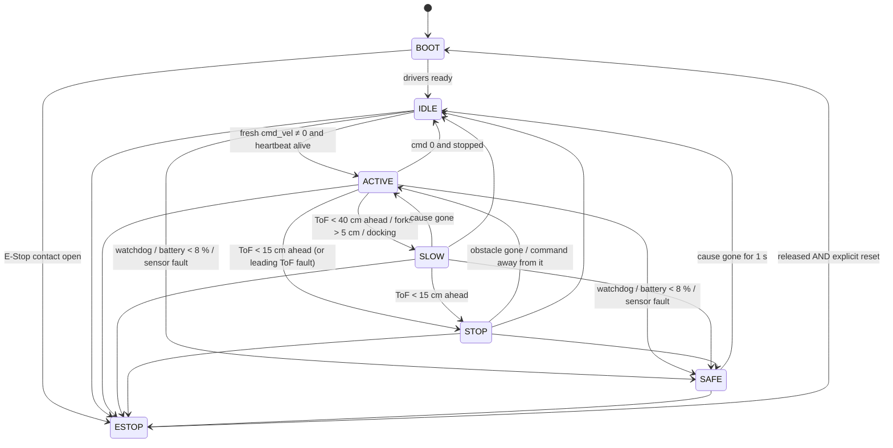

# 12 — ESP32-S3 firmware

Requirements §3 (pins, power), §4 (FW-01..FW-12), §9 (SF-01..SF-13) and §10 (micro-ROS topics). Code:
`robot/firmware/` — build, flash, pin map and calibration steps are in its
[README](https://github.com/Smart-Warhouse/robot/blob/main/firmware/README.md). Plan item B1.

## 1. Structure

The firmware is split so that everything that decides **whether and how fast the forklift may move** is plain
C++17 with no Arduino headers (`lib/forklift_core`), and is unit-tested on the laptop. The board code
(`src/`) only reads sensors, runs the tasks and drives the outputs.

| Layer | Files | Tested |
|---|---|---|
| Core logic | `safety_state_machine`, `safety_limiter`, `kinematics`, `control`, `madgwick`, `calibration`, `config.h` | host, Unity, 60 test cases |
| Drivers | `drivers/` I2C + mutex, H-bridge / servo (LEDC), AS5600, MPU9250, INA219, TCA9548A + VL53L1X, GPIO, WS2812 + buzzer | compiles for the S3; needs the bench |
| Tasks | `tasks.cpp` | compiles; needs the bench |
| Comms | `microros_node.cpp` (flag `FL_ENABLE_MICROROS`), `console.cpp` | console compiles; micro-ROS needs a Linux build |

All tunables are in `lib/forklift_core/src/forklift/config.h`; values not measured yet are marked
`PLACEHOLDER` (wheelbase 0.20 m and steering ± 30° are the same placeholders as the RL simulator).

## 2. Tasks ↔ requirements

| Task | Core / rate / prio | Does | Requirements |
|---|---|---|---|
| `safety_task` | 1 / 1 kHz / 24 | E-Stop level + edge, ToF readings, fork height, battery, link times → `SafetyStateMachine` → speed limit for the motor task. Only task on the hardware task-watchdog (1 s → reboot). | FW-06, FW-07, FW-08, FW-09, SF-02, SF-03, SF-04, SF-08, SF-09, NFR-04 |
| `motor_pid_task` | 1 / 1 kHz / 23 | AS5600 → speed (10 ms window) → drive PID with feed-forward; rear-steer Ackermann → servo; odometry; fork pot → lift controller; limit switches; side shift. Brakes by itself if the safety output is > 5 ms old. Encoder silent > 50 ms → `SENSOR_FAULT`. | FW-01, FW-02, FW-03, FW-04, FW-05 |
| `tof_task` | 1 / 50 Hz / 22 | 6 × VL53L1X (short mode, 20 ms budget) through the TCA9548A; bus lock per sensor; re-initialises dropped sensors every 2 s. | SF-02, FW-10 |
| `imu_task` | 0 / 100 Hz / 10 | MPU9250 accel + gyro → bias removal → Madgwick (6-DoF). `cal imu` averages 500 samples at rest. | FW-05, T-02 |
| `microros_task` | 0 / event / 9 | §10 topics, agent reconnect, ROS parameters for the gains. | §10, FW-03, FW-10, FW-12 |
| `status_task` | 0 / 10 Hz / 5 | INA219 → battery %, LED ring + buzzer. | EL-08, SF-09, SF-12 |
| `loop()` | 1 / lowest | Console: calibration, robot_id, bench mode. | FW-05, FW-12 |

FW-12: `robot_id` (e.g. `fl1`) is read from NVS at boot and becomes the micro-ROS node namespace, so the same
binary publishes `/fl1/wheel_odom` on forklift 1 and `/fl2/wheel_odom` on forklift 2. FW-11: flashing over
the same USB cable from the Jetson (`esptool` / `pio run -t upload`); OTA is not implemented.

## 3. Safety state machine (FW-08)

Priority each 1 ms tick: **ESTOP** → BOOT → SAFE causes → ToF / caps. Details:

- **ESTOP** is latched. Releasing the button alone does nothing (`estop_wait_reset`); a reset that arrives while
  the button is still pressed is ignored. Reset = `safety_reset` topic or console `reset`. SF-01 itself is
  hardware: the NC contact cuts motor power; the firmware reads a second contact (pressed *or unplugged* = ESTOP).
- **SAFE** (FW-06 / SF-04): heartbeat older than 500 ms after the link was once alive, or `cmd_vel` older than
  500 ms while its last value was non-zero (Nav2 died mid-motion), or battery < 8 %, or encoder failure. Speed
  ramps to 0 at 5 m/s² (0.3 m/s → 0 in 60 ms), then motors off. Returns to IDLE after the cause has been gone
  for 1 s; critical battery needs > 11 % (hysteresis).
- **No Jetson (FW-09)**: before the first heartbeat the robot stays in IDLE with reason `no_link` and ignores
  `cmd_vel`. A stale *zero* `cmd_vel` is plain IDLE, not SAFE.
- **ToF ring (SF-02)**: only the sensors facing the direction of motion count — forward: front + two front
  corners; reverse: rear. While turning, the two side sensors may slow (never stop) the robot because the
  rear-steered tail swings out. < 40 cm → cap 30 % of 0.3 m/s; < 15 cm → speed set to 0 in the same tick (no
  ramp, NFR-04). Both the current rolling direction and the commanded one are checked, so the robot can always
  back away from a blocked front. A leading sensor that is stale (> 100 ms) or reports an error stops motion in
  that direction (fail-safe; `TOF_FAULT_STOPS`).
- **SF-03 docking** (`docking_mode` topic): the front centre sensor (sees the pallet) is ignored, the corners
  still stop, speed ≤ 0.1 m/s.
- **SF-08**: forks above 50 mm — or a fork height that cannot be read — cap speed at 0.1 m/s.
- **SF-09**: < 15 % sets `battery_low` (reason in `safety_state`, LED) but keeps driving so the robot can reach
  the charger; the server decides the rest. < 8 % → SAFE.
- All caps keep the command's curvature (v and ω scaled together) so the path does not change, only the speed.
- **SF-12**: green = IDLE/ACTIVE, yellow = SLOW / waiting for link / battery low, red + buzzer =
  STOP / SAFE / ESTOP, blue = boot.

`safety_state` (std_msgs/UInt8) = `state << 4 | reason`. States: 0 BOOT, 1 IDLE, 2 ACTIVE, 3 SLOW, 4 STOP,
5 SAFE, 6 ESTOP. Reasons: 0 none, 1 booting, 2 no_link, 3 tof_slow, 4 tof_stop, 5 tof_fault, 6 fork_raised,
7 docking, 8 watchdog_heartbeat, 9 watchdog_cmd, 10 battery_low, 11 battery_critical, 12 estop_pressed,
13 estop_wait_reset, 14 sensor_fault. These map onto the server's `safety_state` (`normal | slow | stop |
safe | estop`, [02-api-contract.md](02-api-contract.md)) as IDLE/ACTIVE → normal, SLOW → slow, STOP → stop.

## 4. Kinematics and control

- **FW-01 rear-wheel Ackermann.** Reference point = centre of the driven front axle (where the AS5600
  measures), steered axle a wheelbase *L* behind. δ > 0 = rear wheels to the left:
  ω = −v·tan δ / L, δ = atan(−ω·L / v), clamped to ± 30°. To turn left going forward the rear wheels turn
  right. With |v| < 5 mm/s the last angle is held.
- **FW-02 odometry** at 1 kHz with midpoint integration from the measured speed and the commanded steering
  angle (the servo has no feedback), published at 50 Hz.
- **FW-03 speed PID**: feed-forward (1 / speed at full PWM) + PI, derivative on measurement, conditional-
  integration anti-windup. Gains kp 6, ki 80 were chosen on a first-order motor model (τ 0.05–0.12 s,
  ± 25 % gain error) with the quantised AS5600 estimator in the loop.
- **FW-04 lift**: PI on the slide-pot height, dead-band compensation, motor off inside ± 1.5 mm (restart outside
  ± 2.5 mm, no hunting), a pressed limit switch blocks motion further in that direction at once (also latched
  by interrupt). The forks hold their height at boot and after ESTOP / SAFE until a new `lift_cmd`.

## 5. micro-ROS interface (§10)

Exact §10 names, relative to the node namespace `robot_id`:

| Topic | Type | Dir | Rate | QoS |
|---|---|---|---|---|
| `cmd_vel` | geometry_msgs/Twist | in | 20 Hz | reliable |
| `lift_cmd` | std_msgs/Float32 (mm) | in | on demand | reliable |
| `sideshift_cmd` | std_msgs/Int8 (−1/0/1) | in | on demand | reliable |
| `heartbeat` | std_msgs/UInt32 | in | 10 Hz | reliable |
| `wheel_odom` | nav_msgs/Odometry (`odom` → `base_link`) | out | 50 Hz | reliable (larger than the MTU) |
| `imu/data` | sensor_msgs/Imu (`imu`) | out | 100 Hz | best effort |
| `tof_ring` | std_msgs/Float32MultiArray (6 × m, NaN = fault) | out | 20 Hz | best effort |
| `fork_state` | std_msgs/Float32MultiArray `[height_mm, limit_top, limit_bottom, tcrt_l, tcrt_r, at_target]` | out | 20 Hz | best effort |
| `battery` | sensor_msgs/BatteryState | out | 1 Hz | reliable |
| `safety_state` | std_msgs/UInt8 | out | 10 Hz + on change | reliable |

Additions not in the §10 table (proposed for the next revision of the requirements):

| Topic | Type | Why |
|---|---|---|
| `safety_reset` | std_msgs/Empty | FW-08 needs an explicit reset to leave ESTOP |
| `docking_mode` | std_msgs/Bool | SF-03 needs to know when the pallet is meant to be in front |
| `diagnostics` | std_msgs/String (JSON, 1 Hz) | FW-10: per-ToF status, I2C errors, CPU temperature, loop time last/max/overruns per task |

Parameters (FW-03): `drive_kp`, `drive_ki`, `drive_kd`, `drive_kff`, `lift_kp`, `lift_ki`, `save_calibration`.
`fork_state` is called a custom message in §10; it is a `Float32MultiArray` until `forklift_interfaces`
exists (then add it to the micro-ROS build with `extra_packages`).

## 6. What was verified on the host vs what needs the bench

Host (`pio test -e native`, 60 / 60 pass, 2026-10-18):

| Area | Checked |
|---|---|
| State machine | BOOT waits for drivers; no-Jetson stays IDLE and ignores `cmd_vel`; ESTOP latched, ignores reset while pressed, stays latched when released, leaves only on reset; ESTOP during boot returns to BOOT; heartbeat loss → SAFE at 501 ms and **v = 0 by ≤ 600 ms** from the last heartbeat; stale non-zero `cmd_vel` → SAFE, stale zero → IDLE; SAFE recovers after 1 s; sensor fault → SAFE |
| SF-02 | front < 40 cm → 0.09 m/s, < 15 cm → v = 0 in the same tick; reversing ignores all front sensors; forward ignores the rear sensor; can back away from a blocked front; sides only slow while turning; stale or failed leading sensor stops |
| SF-03 / SF-08 | docking ignores the centre sensor, corners still stop, ≤ 0.1 m/s; forks > 5 cm (or unknown) ≤ 0.1 m/s; tightest cap wins; curvature kept |
| SF-09 | < 15 % flag with hysteresis and still drives; < 8 % SAFE until > 11 % |
| FW-01 | straight = 0 steer; left turn forward → rear wheels right; reverse flips; inverse returns ω; saturation; hold at standstill |
| FW-02 / T-05 (model) | 2 m straight; full circle returns to start, diameter 2L/tan δ; reverse arc mirrors; 2 m through the quantised encoder within 1 cm |
| FW-03 / T-03 (model) | step settles ≤ 300 ms and steady error ≤ 5 % for 0.09–0.3 m/s, both directions, motor gain ± 25 %, τ 0.05–0.12 s; anti-windup |
| FW-04 / T-04 (model) | 20 random heights with pot noise and motor dead-band: all within ± 3 mm in < 3.5 s; limit switch stops; no hunting |
| FW-05 | defaults valid; NVS blob round trip; a flipped bit / wrong size / bad value falls back to defaults; CRC32 check value |
| IMU | Madgwick converges to a static tilt; integrates yaw rate; quaternion stays unit |

Board: `pio run -e esp32s3` builds with 0 warnings (RAM 6.7 %, flash 27.1 %). The micro-ROS env has not been
built (needs Linux/WSL2, see the README).

Needs the bench / the forklift (Track C phases 1–2):

| Test | What the host cannot show | How |
|---|---|---|
| **T-02** sensors | real ToF accuracy (± 1 cm), mux wiring, I2C at 400 kHz with motor noise, IMU yaw drift ≤ 2°/min | `tof` and `status` against a ruler / protractor after `cal imu`; watch `i2c_err` in `diag` |
| **T-03** speed PID | the real motor (gain, lag, friction, dead-band), encoder magnet gap | wheels off the ground: `bench on`, `step 0.2 1000` → CSV; retune with `cal drive` or the ROS parameters |
| **T-04** lift PID | real pot linearity and noise, lift dead-band, load | `cal pot …`, then 20 × `lift <mm>` checked with a ruler |
| **T-06** safety | ToF latency and the real stop distance at 0.3 m/s, NFR-04 ≤ 100 ms end-to-end, E-Stop hardware cut (SF-01) | obstacle 20 × at 0.3 m/s; log `safety_state` and `loop_us` in `diagnostics` |
| **T-07** watchdog | USB unplug → stop ≤ 600 ms on the real drivetrain (host: 560 ms on the model) | unplug USB while moving, or `bench off` without the Jetson |

Also bench-only: task timing (`loop_us` max / overruns), the I2C bus shared by the 1 kHz encoder read and the
ToF transfers (if the encoder misses samples, set `AS5600_ON_SECOND_BUS`), LED colours, and the micro-ROS
link (first compile on Linux, then topic rates with `ros2 topic hz`).
