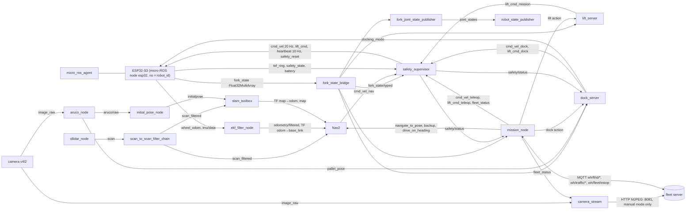

# 13 — ROS 2 workspace (Jetson)

Requirements §5 (JS-*), §6 (PC-*), §7 (NV-*), §8 (AI-05/AI-06), §9 (SF-*), §10. Code: `robot/ros2_ws`
(build and test steps in its [README](https://github.com/Smart-Warhouse/robot/blob/main/ros2_ws/README.md)). Plan item B4. Robot ↔ server contract:
[03-mqtt-contract.md](03-mqtt-contract.md); ESP32 side: [12-firmware.md](12-firmware.md).

All decision logic is plain Python without rclpy and is tested on the laptop; the rclpy nodes are thin wrappers
(`*_node.py`, `*_bridge.py`). Nothing has been built with colcon or run on ROS yet (no Ubuntu on the dev laptop).

## 1. Packages ↔ requirements

| Package | Main files | Requirements |
|---|---|---|
| `forklift_description` | `urdf/forklift.urdf.xacro`, `config/dimensions.yaml` (PLACEHOLDER, = training config), `fork_joint_state_publisher.py` | JS-06, PC-02, ME-04..ME-06 |
| `forklift_interfaces` | `ForkState`, `SafetyState`, `FleetStatus`, `PalletPose`; `Reset`; `Lift`, `Dock`, `MoveTask` | §5, §10 |
| `forklift_bringup` | `bringup.launch.py`, `record.launch.py`, `config/forklift.yaml`, `config/sensors.yaml`, `systemd/forklift.service` | JS-02, JS-05, JS-07, JS-08, NFR-09 |
| `forklift_navigation` | `nav2_params.yaml`, `behavior_trees/navigate_lane.xml`, `slam_*.yaml`, `ekf.yaml`, `maps/*_mask.*` | NV-01..NV-12, PC-10 |
| `forklift_perception` | `aruco_core.py`, `initial_pose_core.py`, `aruco_node.py`, `initial_pose_node.py` | PC-03, PC-04, PC-05, NV-04 |
| `forklift_safety` | `safety_core.py`, `supervisor_node.py`, `fork_state.py`, `fork_state_bridge.py` | SF-02, SF-03, SF-05..SF-08, SF-11, AI-06, NFR-04 |
| `forklift_mission` | `fleet_client_core.py`, `bt.py`, `mission_core.py`, `lane_graph.py`, `transport.py`, `fake_broker.py`, `mission_node.py`, `lift_server_node.py` | CM-01, CM-03, CM-04, SV-03 (robot side), NV-09, NV-10, NV-12, SF-05, SF-10, SF-11, SF-13, FR-01..FR-04 |
| `forklift_rl` | `observation.py`, `policy.py`, `docking_core.py`, `dock_node.py` | AI-05, AI-06, AI-07 (classical fallback), FR-12 |
| `forklift_sim` | Gazebo Fortress twin: `worlds/warehouse.sdf` + `maps/warehouse_sim.*` (generated), `urdf/forklift_gz.urdf.xacro`, `config/bridge.yaml`, `launch/sim.launch.py` — see [19-gazebo-sim.md](19-gazebo-sim.md) | EN-11, AI-01 (plan B5) |
| `forklift_camera_stream` | `mjpeg_core.py`, `sources.py`, `standalone.py`, `camera_stream_node.py` | UI-08 (low-res camera for manual control) |

Key values: Smac Hybrid-A* Reeds-Shepp, min turning radius 0.35 m (= 0.20 / tan 30°, PLACEHOLDER); RPP 20 Hz,
no rotate-in-place; goal 5 cm / 5°; inflation 0.15 m ≥ 0.0935 + 0.03; footprint = chassis + forks, switched to the
pallet-loaded polygon at run time; 2 cm cells; EKF 50 Hz; supervisor 0.3 m/s, 0.1 m/s with forks > 50 mm or docking,
ToF 40 cm → 30 % / 15 cm → stop in the direction of travel, person < 1 m slow / < 0.5 m stop, server loss > 3 s →
finish the step then stop.

## 2. Per-robot graph (namespace `/fl1`, `/fl2`, `/fl3`)

Only the supervisor publishes `cmd_vel`: Nav2 is launched by `forklift_navigation/launch/navigation.launch.py`
with `cmd_vel → cmd_vel_nav` for the controller and behaviour servers and no velocity smoother (Nav2's own
`navigation_launch.py` would publish `cmd_vel` directly). `/tf` and `/tf_static` are remapped into the namespace.

### Topics, types and QoS

ESP32 topics are exactly those of `robot/firmware/src/microros_node.cpp` (all relative to `/<robot_id>`).
Best-effort ESP32 publishers need best-effort (sensor-data) subscribers on the Jetson — a reliable subscriber
never matches them; our nodes use `qos_profile_sensor_data` for them.

| Topic | Type | From → to | Rate | QoS (publisher) |
|---|---|---|---|---|
| `cmd_vel` | geometry_msgs/Twist | safety_supervisor → ESP32 | 20 Hz | reliable |
| `lift_cmd` | std_msgs/Float32 (mm) | safety_supervisor → ESP32 | on change | reliable |
| `sideshift_cmd` | std_msgs/Int8 | (not used yet) → ESP32 | on demand | reliable |
| `heartbeat` | std_msgs/UInt32 (counter) | safety_supervisor → ESP32 | 10 Hz | reliable |
| `safety_reset` | std_msgs/Empty | safety_supervisor (on `safety/reset`) → ESP32 | on demand | reliable |
| `docking_mode` | std_msgs/Bool | dock_server → ESP32 | every Dock step (true), false at the end and at start-up | reliable |
| `wheel_odom` | nav_msgs/Odometry | ESP32 → ekf | 50 Hz | reliable |
| `imu/data` | sensor_msgs/Imu | ESP32 → ekf | 100 Hz | best effort |
| `tof_ring` | std_msgs/Float32MultiArray, 6 × m, NaN = fault, order front, front_left, front_right, left, right, rear | ESP32 → supervisor, dock_server | 20 Hz | best effort |
| `fork_state` | std_msgs/Float32MultiArray `[height_mm (NaN = unknown), limit_top, limit_bottom, tcrt_left, tcrt_right, at_target]` | ESP32 → fork_state_bridge | 20 Hz | best effort |
| `battery` | sensor_msgs/BatteryState (`percentage` 0..1) | ESP32 → mission_node | 1 Hz | reliable |
| `safety_state` | std_msgs/UInt8 = `state << 4 \| reason` | ESP32 → supervisor | 10 Hz + on change | reliable |
| `diagnostics` | std_msgs/String (JSON, FW-10) | ESP32 → rosbag (no Jetson consumer yet) | 1 Hz | reliable |
| `fork_state/typed` | forklift_interfaces/ForkState | fork_state_bridge → supervisor, mission, lift_server, dock_server, fork joint | 20 Hz | best effort |
| `cmd_vel_nav` / `cmd_vel_dock` / `cmd_vel_teleop` | geometry_msgs/Twist | Nav2 / dock_server / mission_node → supervisor | 20 / 20 / 10 Hz | reliable |
| `lift_cmd_mission` / `lift_cmd_dock` / `lift_cmd_teleop` | std_msgs/Float32 (mm) | lift_server / dock_server / mission_node → supervisor | 20 Hz while active | reliable |
| `safety/status` | forklift_interfaces/SafetyState | supervisor → mission_node, dock_server | 10 Hz + on change | reliable |
| `fleet_status` | forklift_interfaces/FleetStatus | mission_node → supervisor, camera_stream | 5 Hz | reliable |
| `image_raw` | sensor_msgs/Image (mono8 640×480, v4l2_camera) | camera → aruco_node, camera_stream | 30 Hz | best effort |
| `pallet_pose` | geometry_msgs/PoseStamped (map) + `pallet_pose/confidence` Float32 | aruco_node → dock_server | camera rate | reliable |
| `pallet_detection`, `aruco/raw` | forklift_interfaces/PalletPose | aruco_node → (logging), initial_pose_node | camera rate | reliable |
| `initialpose` | geometry_msgs/PoseWithCovarianceStamped | initial_pose_node → slam_toolbox | once | reliable |
| `person_distance` | std_msgs/Float32 (m) | YOLO node (not written) → supervisor | — | reliable |
| `local_costmap/footprint`, `global_costmap/footprint` | geometry_msgs/Polygon | mission_node → Nav2 | on load change | reliable |

Actions: `navigate_to_pose`, `backup`, `drive_on_heading` (Nav2), `dock` (forklift_interfaces/Dock), `lift`
(Lift), `move_task` (MoveTask, bench tests without the server). Services: `safety/reset` (Reset), `camera/enable`
(std_srvs/SetBool, stream outside manual mode on request).

### Manual-control camera (`forklift_camera_stream`, UI-08)

`camera_stream` serves `GET http://<robot>:8081/stream.mjpg` (multipart/x-mixed-replace, boundary `frame`, one JPEG
per part with `Content-Length`) and `GET /health`. The fleet server relays it to the dashboard
(`GET /api/robots/{id}/camera`, [02-api-contract.md §3.3](02-api-contract.md)); the robot is configured in
`warehouse_map.yaml` as `camera_url`. Rules, all in the rclpy-free `mjpeg_core.py`:

- 320×240, ≤ 10 fps, JPEG quality 60 (parameters `width`, `height`, `fps`, `jpeg_quality`); each frame is encoded
  once for all viewers and nothing is encoded while nobody watches;
- only while `fleet_status.mode == "manual"` or after `camera/enable` (true) / `always_on: true`; otherwise `409
  camera_inactive`, and open streams end as soon as the robot leaves manual mode;
- shared token (`Authorization: Bearer` or `?token=`, constant-time compare) read from `token_file`
  (`/etc/forklift/camera_token`, chmod 600) = the server's `CAMERA_TOKEN`; empty = open (bench only);
- at most `max_clients` (2) viewers (`503`); a viewer that disconnects ends its loop on the next write; a stream with
  no frame for `stall_timeout_s` (5 s) ends.

Laptop / bench without ROS: `python -m forklift_camera_stream.standalone --source 0` (webcam) or `--source test`
(synthetic colour bars + clock), from `src/forklift_camera_stream` with the host venv; starting it is the explicit
request, so it streams whatever the mode. The capture device opens with the first viewer and closes with the last.

`fork_state` migration: when the firmware is built with `forklift_interfaces` (micro-ROS `extra_packages`) it
publishes `ForkState` on `fork_state` (same field order); then delete `fork_state_bridge` and set the
`fork_state_topic` parameters in `forklift.yaml` to `fork_state`.

### MQTT side (mission_node, docs/03 exactly)

Last Will `{"online": false}` on `wh/fl/{id}/state` (QoS 1, not retained) and the same on a clean stop; state 2 Hz
QoS 0 with `seq` + `ts` (one counter for every topic); `task_status` accepted → to_pickup → picking → to_drop →
dropping → done | failed + `reason` (`nav_failed: …`, `pickup_failed: …`, `invalid task: …`); lane by lane
`request` on `wh/traffic/<from>--<to>`, wait for our own `grant`, re-request every 500 ms, `release` on arrival;
`cmd` pause / resume / cancel (task_id-filtered) / go_charge / reset / mode; `teleop` only in manual (0.5 s
dead-man); retained `wh/fleet/estop` holds the robot. Task status, events and releases produced while offline are
queued and sent on reconnect. Keep-alive 2 s so a broker loss is seen inside the SF-05 3 s budget.

## 3. Verified on the host vs needs Ubuntu / hardware

Host: `.venv/Scripts/python -m pytest -q` in `robot/ros2_ws` — 303 passed, 1 skipped (real-broker test), 2026-10-18 (with `forklift_camera_stream`).

| Area | Checked on the host |
|---|---|
| MQTT contract | will / credentials / subscriptions, 2 Hz state, seq + ts, grant/deny/500 ms retry, foreign grants ignored, retained E-stop on connect, teleop clamp + dead-man, bad JSON, offline queue; every published message validated against `docs/schemas/*.json` |
| Mission | full task through all phases against a fake fleet server with lane locks (all lanes requested and released in order), NV-10 3 failures → `failed` + `nav_failed` event + `error` mode, recovery after 2 failures, pickup failure backs out, pause/resume, fleet E-stop, SF-05 server loss (step finishes, nothing new, `wifi_lost` event on reconnect; optional reset policy), cancel mid-lane, task replacement, QoS-1 duplicates, invalid tasks, routeless tasks, go_charge, manual/auto |
| Safety | speed/accel/curvature clamp, SF-08, SF-03 (centre ToF ignored, corners still stop), SF-02 by direction, faulted ToF, person slow/stop, mode gating of sources, SF-05, command + fleet watchdogs, firmware safety byte decoding, unknown fork height, lift forwarding |
| Perception | ArUco 30 mm and 60 mm, 0.2–0.5 m, ± 25°: ≤ 1 cm and ≤ 2° per frame on rendered images (PC-04); 5-sample average reduces jitter (PC-05); initial pose from a rendered charger marker ≤ 1 cm / ≤ 1° (NV-04) |
| RL | observation identical (< 1e-5) to 718 states recorded from `ai/training/forklift_rl/env.py`; bringup `docking:` = training `config.yaml`; ONNX runner on a generated model; classical controller docks in closed loop on a kinematic model; marker-lost / safety-stop / timeout |
| Camera stream | JPEG resize/quality, multipart framing round trip, rate limiter (no backlog), token check, manual-mode gate, mono8/rgb8/yuv422 conversion, live HTTP: 401 / 409 / 200 / 503, viewer leaves → source stops, leaving manual mode ends the stream |
| Config | URDF expands (pip xacro) into one tree rooted at `base_link`; Nav2 footprint = dimensions; filter masks and Gazebo world regenerate identically from the map; every bringup parameter is declared by its node; all XML/YAML parse, all Python compiles, cores import no ROS |

Needs Ubuntu 22.04 + Humble (plan B3): `colcon build` (interfaces generation, setup.py installs), every launch file
and node actually starting, Nav2 accepting the parameters (Humble plugin names, costmap filter topic resolution
inside a namespace, Smac/RPP tuning), slam_toolbox in a namespace, robot_localization QoS against the best-effort
`imu/data`, the micro-ROS agent with the real firmware, RViz.

Needs the forklift (Track C): real dimensions / turning radius (all PLACEHOLDER), camera calibration (PC-01) and
extrinsics (PC-02), ArUco on real images (T-10), localisation ≤ 3 cm (T-08), navigation (T-09), docking RL vs
classical (T-12), TensorRT latency ≤ 5 ms (AI-05), full tasks with the server (T-13, T-14), network loss (T-16).

## 4. Contract ambiguities and decisions

- **Last Will vs schema:** docs/03 fixes the will payload to `{"online": false}`, but `state.schema.json` requires
  `seq` and `ts`. The robot sends exactly `{"online": false}` (the server handles it); the schema should allow it.
- **Server loss (SF-05) vs the reference client:** `tools/mqtt_robot_client` goes SAFE and waits for an operator
  `reset`; SF-05 / T-16 ask to finish the segment, stop and *resume* when the link returns. Default = resume;
  `require_reset_after_server_loss: true` restores the reference behaviour.
- **`from.node` / `to.node`** are not in `task.schema.json` but the server sends them; the robot uses them, else the
  location code (warehouse map), else the nearest node to x, y.
- **`task_id` in state** and **`task_id` in `cmd: cancel`** are extensions (server and reference client use them).
- **Cancel mid-lane:** the robot finishes the lane it holds (and releases it), backs out of an unlifted pallet and
  lowers the forks; it reports no further `task_status` (the server already cancelled the task).
- **Reset:** a fleet `reset` is always forwarded to the ESP32 (`safety_reset`), whatever the mission mode, because
  a hardware ESTOP is only left on an explicit reset (FW-08).
- **Steering angle:** the ESP32 publishes none (servo without feedback); the RL observation recovers it from
  wheel odometry (which the firmware integrates with the commanded angle), so obs[7] is the commanded angle.
- **Charger marker height:** with the camera on the carriage pitched 20° down and the robot 0.2 m from the wall,
  a 60 mm marker is fully in view only when mounted low (centre ≈ 2 cm); measured poses go in `markers.yaml`.
- **Docking success on the robot** uses both TCRT5000 + insertion depth from the estimate with a 2 cm lateral
  check (the simulator's 1 cm uses ground truth).
