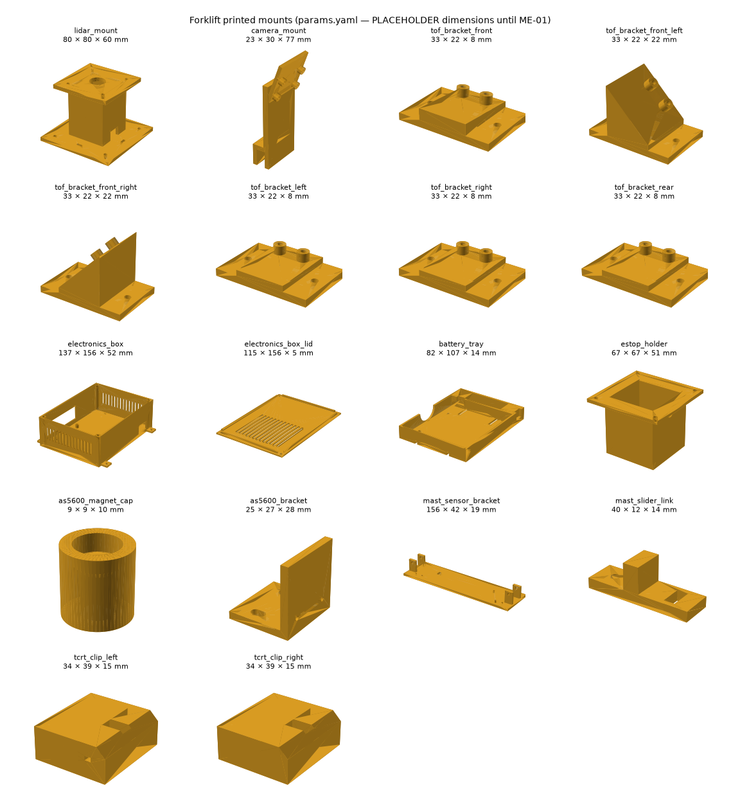
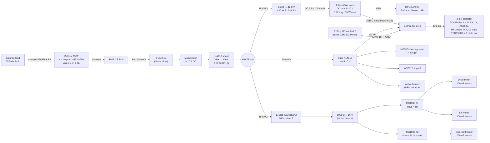

# 14 — Hardware build: printed mounts, wiring, parts still to buy

Requirements §2 (ME-04 … ME-12), §3 (EL-01 … EL-10, pin table). Plan items A3 and A4. Bench tests that follow
this build: [15-bench-tests.md](15-bench-tests.md). Firmware side: [12-firmware.md](12-firmware.md) and
[code/firmware/README.md](../code/firmware/README.md).

> **Status 2026-10-18:** CAD written and tested on the laptop, nothing printed or wired yet. Only the
> Huina 1577 Pro outer size (52.4 × 18.7 × 31.7 cm) is real; every other mechanical number is a
> **PLACEHOLDER** until the first forklift is opened and measured (ME-01, plan A2). The pin map below is
> copied from `config.h`, which stays the source of truth.

## 1. Printed mounts (CadQuery)

Code: [`code/cad/`](../code/cad/). One parameter file, [`params.yaml`](../code/cad/params.yaml), holds every
dimension (41 values marked PLACEHOLDER); the values shared with the RL simulator
(`code/training/forklift_rl/config.yaml`) and the firmware (`LIFT_MAX_MM`) are kept equal and a test checks it.

```powershell
cd code/cad
py -3.11 -m venv .venv
.venv\Scripts\pip install -r requirements.txt
.venv\Scripts\python build.py        # STL + STEP → code/cad/out/ (gitignored), PNG → docs/media/cad/
.venv\Scripts\python -m pytest -q    # every part builds, is one valid solid, fits 220 × 220 × 250, ME-* checks
```

After measuring: change `params.yaml` only → `build.py` → `pytest` → slice the STLs. Print in **PETG** (PLA
softens at ~55 °C next to the Jetson and the motors), 0.2 mm layers, 4 perimeters, 30 % gyroid, no supports
except where noted.

| Part (file in `out/stl/`) | Qty | Req. | What it does | Print / fit notes |
|---|---|---|---|---|
| `lidar_mount` | 1 | ME-04 | 80 × 80 base on the overhead-guard roof (4 × M3 through-bolts or 4 zip-ties round the bars), hollow 40 mm riser (USB cable inside, exits at the bottom), 60 × 60 top plate with 4 × M2.5 for the RPLIDAR C1 | Riser height is **computed**: scan plane = max(mast top + mast rise at full lift, carried load top) + 15 mm |
| `camera_mount` | 1 | ME-05 | U-clamp over the fork-carriage cross bar (M3 set screw), arm, plate tilted **20°** down (15–25 allowed) with 4 M2 bosses for Camera Module 3 | Print lying on its side; moves with the carriage. CSI ribbon ≥ 300 mm with a service loop for the full lift |
| `tof_bracket_front` | 1 | ME-06 | under the forks, carriage centre, 5° up so the floor is not seen | 2 × M2 into the body, board on 2 × M2 standoffs |
| `tof_bracket_front_left` / `_front_right` | 1 + 1 | ME-06 | front corners, sensor turned 45° outwards | wedge block, prints without support |
| `tof_bracket_left` / `_right` / `_rear` | 1 + 1 + 1 | ME-06 | sides mid-body and the rear counterweight | flat brackets |
| `electronics_box` + `_lid` | 1 + 1 | ME-10 | Jetson Orin Nano on 4 standoffs + 5 × 7 cm perfboard (ESP32-S3 Zero, MX1508 × 2, TCA9548A, INA219, MPU9250) behind the seat; Jetson I/O window, cable port, side vent slots, lid slots over the fan, 4 × M3 heat-set inserts for the lid, 4 × M3 ears | Vent area ≥ 100 mm² per Jetson watt (test). MPU9250 goes on the perfboard **far from the boost converter and motor wires** (magnetometer not fused anyway) |
| `battery_tray` | 1 | ME-11 | low rear tray for the 4-slot 18650 holder + BMS pocket, two 20 mm Velcro strap slots, finger notch to lift the holder out for charging, 4 × M3 to the chassis | Counterweight side; XT30 lead exits by the BMS |
| `estop_holder` | 1 | ME-12 | pedestal at the rear top with the 22 mm hole + anti-rotation key, room for the contact blocks, flange with 4 × M3 | Print panel-down. One-hand reach from behind |
| `as5600_magnet_cap` + `as5600_bracket` | 1 + 1 | ME-07 | cap pressed on the drive axle stub holds the 6 × 2.5 mm magnet flush; bracket holds the AS5600 board facing it. Nominal gap **1.5 mm**; slotted foot sets it anywhere in 0.5–3 mm | Glue the magnet (CA) **centred**; set the gap with a feeler gauge / 1.5 mm drill shank |
| `mast_sensor_bracket` + `mast_slider_link` | 1 + 1 | ME-08 | plate clamped on the mast upright (2 cheek clamps, M3 cross bolts): limit switches exactly `lift_max` apart, slide pot beside them; the link bolts to the carriage, grips the pot knob and carries the tab that presses the switches | Pot travel (60 mm PLACEHOLDER) < lift range (120 mm PLACEHOLDER): the test warns — see §6 |
| `tcrt_clip_left` / `_right` | 1 + 1 | ME-09 | sleeve over each fork tip + nose with a pocket for the bare TCRT5000 head facing up; leads leave towards the inner side | Total 15 mm thick, fits the 19 mm pallet opening with 2 mm margin (test). The nose lengthens the forks by 14 mm → add it to `fork_length` in the RL config after fitting |

Previews: [all parts](media/cad/all-parts.png) and one PNG per part in [`media/cad/`](media/cad/).



Weight (ME-14, ≤ 700 g for all add-ons): `build.py` prints each part's solid volume and a 100 %-infill PETG
mass (upper bound); at 30 % infill the prints weigh roughly half of it. Weigh the real prints.

## 2. Power tree (EL-01 … EL-08)



Rules:

1. **Order on the + side** (EL-01): BMS P+ → fuse → main switch → INA219 Vin+ → Vin− → +BATT bus. The INA219
   sits after the switch so it measures everything (EL-08) and its bus-voltage reading is the battery voltage
   minus fuse/switch drop (≈ 0.05 V, fine for SF-09).
2. **E-Stop cuts only the motor branch** (EL-02, SF-01): Jetson, ESP32 and sensors stay on, log and report.
   The XB2-**BS542** has one NC block; the firmware also wants a **second NC contact** wired GPIO 18 ↔ GND
   (pressed or broken wire reads HIGH = ESTOP). Clip a **ZBE-102 (NC) contact block** onto the same head —
   not on the parts list yet (§5).
3. **Capacitors** (EL-03): 1000 µF / 16 V low-ESR electrolytic on the motor rail right at the MX1508 VM pins;
   100 nF ceramic soldered across each motor's terminals (optionally 2 more, terminal → motor can). 470 µF
   at the servo plug, 10 µF + 100 nF at the ESP32 5 V pin.
4. **Buck** (EL-04): set the XL4015 to **5.10 V with a multimeter before connecting anything**, at no load
   and again with a 1 A load (servo stalled). T-01 then checks ± 5 %.
5. **Boost for the Jetson** (EL-05): the Orin Nano DC jack accepts 9–20 V only (the requirement's NVIDIA
   check) — a 2S pack never reaches it, so a boost converter to **12.0 V, ≥ 30 W, input 6–8.4 V** is required.
   At 15 W and 6.0 V the input current is ≈ 2.8 A; take a module rated ≥ 8 A input (e.g. a 150 W XL6019-class
   board), not a small XL6009. Set 12.0 V before plugging the Jetson.
6. **Star ground** (EL-06): one ground point (a screw terminal / bus bar next to the BMS P−). Separate returns
   from: boost, buck, motor drivers, INA219/logic. Never daisy-chain motor ground through the ESP32.
7. **INA219 shunt**: the GY-219 board ships with a 0.1 Ω shunt (R100) → with the firmware's ±320 mV range it
   reads only **± 3.2 A**, but the peak is ≈ 36 W / 7.4 V ≈ 5 A (6 A at 6.0 V). Desolder R100 and fit a
   **0.01 Ω 1 % 2512 (R010)** → ± 32 A range, 1 mA steps. Then change `INA219_SHUNT_OHM` to `0.01f` in
   `config.h` (it is marked PLACEHOLDER there). The shunt carries the full current: use the screw terminals,
   not the 2.54 mm header pins.
8. **Fuse rating — decide**: EL-01 says 5 A. The power budget peak (≈ 36 W) is 4.9 A at 7.4 V but **6.0 A at
   6.0 V** (nearly empty pack). A 5 A slow-blow blade survives short peaks; if it blows at low battery during
   T-01, go to 7.5 A (the BMS still trips at 20 A and wiring is 18 AWG, good for > 10 A).
9. **Battery holder**: the 4-slot ABS holder is wired **4S in series** from the factory (14.8 V). Rewire it as
   **2S2P** (cells 1 ∥ 2 and 3 ∥ 4, then the two pairs in series) or the Jetson boost, buck and drivers see
   16.8 V. Check with a multimeter: 7.4–8.4 V across the output. Add a JST-XH 3-pin balance lead (0 V,
   mid-point, 8.4 V) for the IMAX B3, and only parallel cells that are within 0.05 V of each other.
10. **5 V back-feed check**: the ESP32 gets 5 V from the buck *and* its USB-C goes to the Jetson. Before the
    first power-up, check on the Waveshare ESP32-S3 Zero schematic / with a meter whether VBUS and the 5V pin
    are separated by a diode. If they are joined, cut the 5 V wire of the Jetson↔ESP32 USB cable (data +
    ground only) so the two supplies never fight.
11. **MX1508**: VM 2–10 V, 1.5 A continuous / 2.5 A peak per channel — fine on 8.4 V **if** ME-02 measures the
    drive motor stall below 2.5 A; otherwise use the BTS7960 / 15 A spare from the BOM for the drive motor.

## 3. ESP32-S3 Zero pin map (from `config.h`)

Source of truth: [`code/firmware/lib/forklift_core/src/forklift/config.h`](../code/firmware/lib/forklift_core/src/forklift/config.h).
Verify every pad against the real Waveshare Zero before soldering (plan A4). No strapping pins (0, 45, 46),
no PSRAM / flash pins; GPIO 19/20 are the native USB (micro-ROS), GPIO 21 is the on-board RGB LED.

| Function | GPIO | Wire to | Electrical |
|---|---|---|---|
| Drive motor IN1 / IN2 | 2 / 3 | MX1508 #1 IN1 / IN2 | LEDC 20 kHz, 10-bit |
| Lift motor IN1 / IN2 | 4 / 5 | MX1508 #1 IN3 / IN4 | LEDC 20 kHz |
| Side-shift IN1 / IN2 | 6 / 7 | MX1508 #2 IN1 / IN2 | LEDC 20 kHz (no position feedback, 3 s timeout) |
| Steering servo | 11 | MG90S signal (orange) | 50 Hz, 14-bit; servo power from the 5 V buck |
| Fork slide pot | 1 | pot wiper; ends to 3V3 / GND | ADC1_CH0, 11 dB — **never 5 V on the pot** |
| I2C SDA / SCL | 12 / 13 | TCA9548A, AS5600, MPU9250, INA219 | 400 kHz, 4.7 kΩ pull-ups to 3V3 once on the main bus |
| Limit top / bottom | 14 / 15 | micro switch COM → GND, NO → GPIO | internal pull-up, active LOW, interrupt |
| TCRT5000 left / right | 16 / 17 | module DO | module powered 3.3 V, active LOW |
| E-Stop second contact | 18 | ZBE-102 NC → GND | pull-up; pressed / unplugged = HIGH = ESTOP. **Bench without E-Stop: tie 18 to GND** |
| WS2812 ring (7 LEDs) | 38 | DIN (330 Ω series) | ring powered 5 V; 3.3 V data usually works at 5.1 V — if it flickers, use one TXS0108E channel or a 74AHCT125 |
| Active buzzer | 39 | 1 kΩ → NPN base (S8050 / 2N2222), buzzer 5 V → collector | do not drive a 5 V buzzer straight from the pin |
| micro-ROS | USB 19 / 20 | Jetson USB | USB CDC; with micro-ROS on, the console moves to UART0 (GPIO 43 TX / 44 RX) |
| (optional) AS5600 2nd bus | 8 / 9 | AS5600 SDA / SCL | only if `AS5600_ON_SECOND_BUS = true` (off by default) |

The 3V3 pin of the Zero feeds all sensors (≈ 200 mA: 6 ToF ≈ 120 mA while ranging, TCRT LEDs ≈ 40 mA, the
rest a few mA) plus the ESP32 itself; this is within the board regulator but measure it in T-01. EL-09: every
sensor here runs on 3.3 V logic, so the TXS0108E is only needed if a 5 V-logic part is added (TXS0108E is a
poor match for I2C and long WS2812 lines — keep I2C on 3.3 V only).

### I2C bus and TCA9548A channels

| Address | Device | Bus position |
|---|---|---|
| 0x70 | TCA9548A mux (A0–A2 to GND) | main bus |
| 0x36 | AS5600 encoder (fixed address) | main bus (or the 2nd bus, GPIO 8/9) |
| 0x68 | MPU9250 (AD0 to GND) | main bus |
| 0x40 | INA219 (A0, A1 to GND) | main bus |
| 0x29 | VL53L1X × 6 (all the same address) | one per mux channel, below |

| Mux channel | ToF (firmware `TofIndex`) | Bracket | Notes |
|---|---|---|---|
| 0 | 0 `front` | `tof_bracket_front` | under the forks; ignored while docking (`TOF_MASK_DOCKING_IGNORE`, SF-03) |
| 1 | 1 `front_left` | `tof_bracket_front_left` | 45° outwards |
| 2 | 2 `front_right` | `tof_bracket_front_right` | 45° outwards |
| 3 | 3 `left` | `tof_bracket_left` | counts only while turning |
| 4 | 4 `right` | `tof_bracket_right` | counts only while turning |
| 5 | 5 `rear` | `tof_bracket_rear` | |
| 6, 7 | free | | |

The mapping is `TOF_MUX_CHANNEL = {0,1,2,3,4,5}` in `config.h` (PLACEHOLDER wiring): wire it this way and the
file needs no change. Each mux channel is its own bus segment, so the "< 30 cm, twisted" rule (EL-07) applies
per ToF cable — the front sensors are ~25–35 cm from the box; if a cable must be longer, mount the TCA9548A
mid-body instead of in the box. Use the boards' XSHUT pins unconnected (the mux makes address changes unnecessary).

## 4. Wires and connectors (EL-07)

| Run | Gauge | Connector | Notes |
|---|---|---|---|
| Battery → BMS → fuse → switch → INA219 → bus | 18 AWG silicone | XT30 (battery side, keyed) | red/black, ≤ 15 cm |
| Bus → boost, bus → E-Stop → drivers | 18 AWG | screw terminals / XT30 | |
| Driver → motors (drive, lift, side-shift) | 18–20 AWG | JST-SM or JST-XH 2-pin, unpluggable (ME-03) | twist each pair, 100 nF at the motor |
| Boost → Jetson | 20 AWG | DC barrel 5.5 × 2.5 mm, centre + | |
| Buck → ESP32 5V, servo, LED ring, buzzer | 22 AWG | JST-XH 2/3-pin | |
| I2C to each ToF (VIN, GND, SDA, SCL) | 26 AWG, twisted pairs (SDA+GND, SCL+3V3) | JST-XH 4-pin | < 30 cm per segment |
| Limit switches, TCRT5000, pot, E-Stop sense | 24–26 AWG | JST-XH 2/3-pin | pot wire runs up the mast with a service loop |
| Camera | CSI ribbon (Jetson 22-pin ↔ Cam 3 15/22-pin, check the adapter) | | ≥ 300 mm, loop for the lift travel |
| LiDAR | its own USB cable inside the riser | USB-A | strain-relief with a zip-tie at the base |
| Balance lead | 22–24 AWG | JST-XH 3-pin | to the IMAX B3 for charging |

## 5. Not on the parts list yet (per forklift unless noted)

The BOM PDF ([parts-bom.pdf](00-sources/parts-bom.pdf)) has none of these. ✱ = blocks the first power-up.

| Item | Qty | Why | Suggestion |
|---|---|---|---|
| ✱ Boost converter 6–8.4 V → 12 V, ≥ 30 W | 1 | EL-05: Jetson DC jack needs 9–20 V | 150 W XL6019-class module, ≥ 8 A input |
| ✱ Shunt resistor 0.01 Ω 1 % 2512 (R010) | 1 | INA219 stock 0.1 Ω reads only ± 3.2 A | + set `INA219_SHUNT_OHM = 0.01f` |
| ✱ Blade fuse 5 A (+ a 7.5 A spare) and inline holder | 1 | EL-01 | slow-blow; see §2 rule 8 |
| ✱ Main switch, ≥ 10 A DC | 1 | EL-01 | rocker / toggle |
| ✱ E-Stop extra NC contact block ZBE-102 | 1 | second contact for GPIO 18 (SF-01 sensing) | clips onto the XB2 head |
| ✱ Capacitors: 1000 µF/16 V low-ESR ×1, 470 µF/10 V ×1, 10 µF ×2, 100 nF ceramic ×10 | 1 set | EL-03 | |
| ✱ DC barrel cable 5.5 × 2.5 mm | 1 | Jetson power | |
| ✱ XT30 pairs | 3 | battery / BMS / bus | |
| JST-XH kit (2/3/4-pin housings + crimps) + crimper (fleet) | 1 kit | ME-03, sensors | or JST-SM for motors |
| Silicone wire 18 AWG red/black, 22 AWG, 26 AWG twisted / ribbon | 2 m each | EL-07 | |
| NPN transistor S8050 / 2N2222 + 1 kΩ | 1 | buzzer driver | |
| 330 Ω resistor | 1 | WS2812 data | |
| 4.7 kΩ resistors | 2 | I2C pull-ups if no board has them | most breakouts already do |
| Perfboard 5 × 7 cm + female headers | 1 | EL-10 prototype | |
| Diametric magnet 6 × 2.5 mm | 1 | ME-07 | often in the AS5600 kit — check |
| JST-XH 3-pin balance lead | 1 | charging with the IMAX B3 | |
| Velcro strap 20 mm | 0.3 m | battery tray | |
| Screws: M2 × 6 (≈ 20), M2.5 × 6 (8), M3 × 8 / 12 / 16 (≈ 30) + M3 nuts (10) | 1 set | all mounts | stainless or zinc |
| Heat-set inserts M3 (OD 4.0, L 5) | 4 | box lid | + M2.5 ×4 optional for the Jetson standoffs |
| Zip-ties 2.5 mm, heat-shrink, ferrules | 1 pack (fleet) | | |
| PETG filament | ≈ 0.5 kg (fleet ≈ 1 kg) | all prints | |
| USB-UART adapter, 3.3 V (CP2102 / CH340) | 1 (fleet) | console on UART0 (GPIO 43/44) when micro-ROS owns the USB — T-07 | |
| Optional: 74AHCT125 | 1 | only if the WS2812 flickers on 3.3 V data | |
| Optional: longer slide pot (≥ lift range) | 1 | if ME-01 confirms pot travel < lift range | see §6 |

## 6. Open points to settle after ME-01

- **Pot travel vs lift range**: `params.yaml` has pot travel 60 mm and lift 120 mm (both PLACEHOLDER) — the
  pot would not cover the range. Measure both; if it is still short, buy a ≥ 100 mm slide pot, or lower
  `LIFT_MAX_MM` (firmware), `lift_max` (RL config) and `forklift.lift_max` (params.yaml) together.
- **Mast rise**: if the inner mast rises above the outer one at full lift, set `mast_rise_at_max_lift`; the
  LiDAR riser grows automatically and the test re-checks the scan plane.
- **Axle access for the AS5600**: the cap needs a free axle stub on the drive axle (or a gear shaft with
  `DRIVE_GEAR_RATIO` in `config.h`). Measure diameter, D-flat, stub length and the face the bracket sits on.
- **Rear cover space**: `rear_cover_inner` (150 × 160 × 75 mm PLACEHOLDER) decides whether the Jetson box fits
  behind the seat; the test fails if it does not.
- **Fork nose**: the TCRT clip adds 14 mm to each fork — update `fork_length` in the RL config (and retrain)
  only if the docking insertion target changes.
