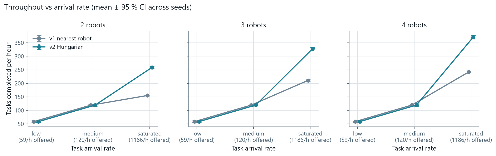
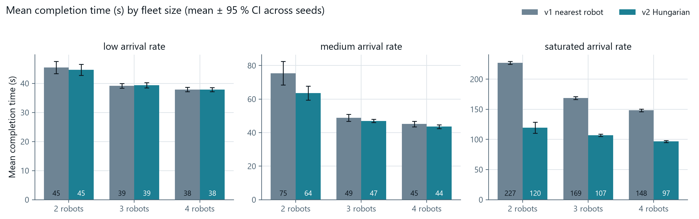
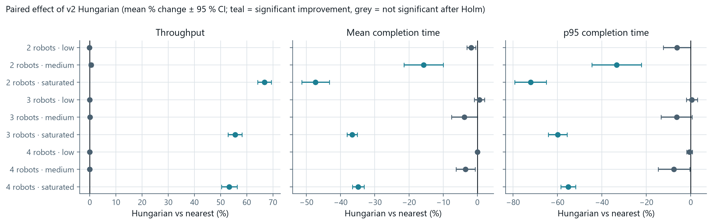
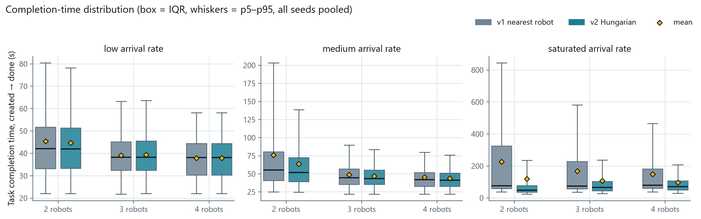
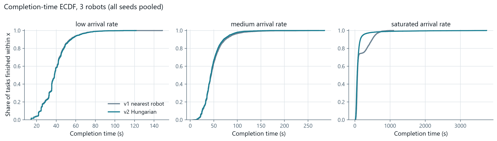
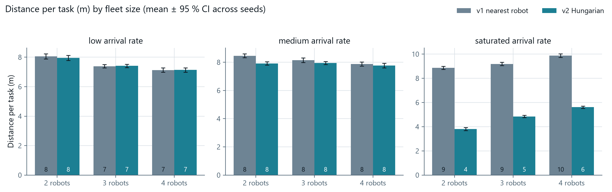

# 18 — Task allocation study (AI-08): v1 nearest robot vs v2 Hungarian

Requirement **AI-08**: server-side task allocation, v1 a simple rule (nearest robot with enough battery),
then an improvement (Hungarian algorithm), *compared by mean task completion time*. Code:
[`code/experiments/allocation/`](../code/experiments/allocation/) (runner, analysis, smoke test);
raw data in `code/experiments/allocation/results/`; charts in [`media/allocation/`](media/allocation/).

**Result in one paragraph.** When work arrives slower than the fleet can serve it, the two strategies are
practically the same: identical at the low rate, and at the medium rate Hungarian is 3–16 % faster on mean
completion time (significant only with 2 robots). When the queue is always full (saturated), Hungarian
completes **53–67 % more tasks per hour** and cuts mean completion time by **35–47 %**, every cell
p < 0.001 with very large effect sizes. The gain does not come from smarter robot *assignment* so much as from
task *selection*: with one free robot and ten queued tasks, Hungarian picks the task nearest that robot
(distance per task halves), while v1 serves the highest-priority task wherever it is. The price is that
Hungarian ignores task priority and lets a few far-away tasks wait a very long time (worst case > 1 h with 2
robots). The study confirms the earlier quick stress run (≈ 300 vs ≈ 210 tasks/h): 328 vs 211 tasks/h with 3
robots, but only for the saturated regime.

## 1. Method

### 1.1 What is simulated

The experiment drives the **real Fleet Manager** (`app.fleet.manager.FleetManager`), not a re-implementation:
A* routing on the lane graph of `app/warehouse_map.yaml`, node + lane locks, deadlock detection and back-off,
the battery policy, the simulated forklift motion (0.3 m/s, 0.1 m/s docking, 3 s fork action) and the WMS
transactions. Each run gets its own in-memory SQLite database, migrated and seeded exactly as the server does at
start-up (12 pallets, 22 non-charger locations). The manager is advanced with `tick(0.1)` in simulated
seconds; no wall clock is involved, so a run is fully determined by its seed (checked by the smoke test).
Timestamps are taken from the manager's simulated clock (a recording `Hub` sees every task status change).

| Factor | Levels |
|---|---|
| Strategy | `nearest` (v1, greedy in priority order) · `hungarian` (v2, Kuhn–Munkres minimising total travel to the pickups) |
| Fleet size | 2, 3, 4 robots (temporary copy of the map with the first N robot entries, all enabled; fl4 = the spare) |
| Arrival rate | low 60 tasks/h · medium 120 tasks/h · saturated 1200 tasks/h (Poisson) |
| Seeds | 15 per cell, the same 15 for both strategies (paired design) |
| Run length | 300 s warm-up (not measured) + **2 simulated hours** measured |
| Fixed | `sim_failure_rate` = 0.03 per pickup attempt (two failures = task failed); battery drain and charging on, start charge U(40, 100) % per robot |

Total: 2 × 3 × 3 × 15 = **270 runs, 540 simulated hours**, 14 min wall-clock on 12 worker processes.

**Demand.** Arrivals form a Poisson stream. An arrival joins an order backlog and becomes a WMS task through
`create_task` as soon as a stored pallet and a free destination exist; pallet, destination and priority (1–4)
are drawn uniformly from those. With 12 pallets and 22 locations at most 10 tasks can be open at once, so the
saturated rate keeps the WMS queue full and measures capacity. The arrival times, the pallet/destination
draws and the starting battery levels come from random streams that depend only on the seed (common random
numbers), so both strategies face the same demand.

**Rates were calibrated** on a pilot: capacities at saturation were ≈ 155 / 210 / 245 tasks/h for v1 with
2 / 3 / 4 robots. Low (60/h) loads 2 robots to ≈ 33 %; medium (120/h) is ≈ 75 % of v1's 2-robot capacity
and ≈ 50 % of its 4-robot capacity.

### 1.2 Metrics (per run, measured window only)

| Metric | Definition |
|---|---|
| Tasks per hour | tasks reaching `done` in the window ÷ 2 h |
| Completion time | task created in the WMS → `done` (the AI-08 metric); mean, median, p95, max |
| Queue wait | created → assigned to a robot |
| Lane-lock wait | per task: time spent waiting for a node/lane lock while carrying out the task (`Task.wait_s`) |
| Utilisation | share of robot-time with a task assigned |
| Distance per task | metres driven while carrying out the task (`Task.distance_m`) |
| Deadlocks resolved | `deadlock_resolved` events |
| Failures | tasks ending `failed` (two failed fork insertions) |

Aggregation: mean ± 95 % CI (Student t, 14 df) across the 15 seeds. Comparison: per (fleet size, rate), paired
difference Hungarian − nearest per seed, paired t-test with **Holm correction across the 9 cells**, Wilcoxon
signed-rank as a non-parametric check, and Cohen's *d*z (mean difference ÷ SD of differences) as effect size.

## 2. Results

Full tables for every metric: `code/experiments/allocation/results/tables.md`; per-run data `runs.csv`, per-task
data `tasks.csv`, aggregates `summary_by_cell.csv`, tests `paired_tests.csv`, priority breakdown
`priority_breakdown.csv`.

### 2.1 Throughput



| Robots | Rate | v1 nearest (tasks/h) | v2 Hungarian | Δ [95 % CI] | Δ % | *d*z | p (Holm) |
|---|---|---|---|---|---|---|---|
| 2 | low | 58.6 ± 2.8 | 58.5 ± 2.8 | −0.1 [± 0.1] | −0.2 % | −0.48 | 0.50 |
| 2 | medium | 119.1 ± 3.5 | 119.7 ± 3.9 | 0.5 [± 0.8] | 0.4 % | 0.37 | 0.87 |
| 2 | saturated | 155.1 ± 1.9 | **258.7 ± 3.2** | 103.6 [± 4.1] | **+66.8 %** | 14.2 | < 0.001 |
| 3 | low | 58.6 ± 2.9 | 58.6 ± 2.9 | 0 (identical runs) | 0 % | — | 1 |
| 3 | medium | 119.7 ± 4.0 | 119.8 ± 3.9 | 0.1 [± 0.2] | 0.1 % | 0.30 | 1 |
| 3 | saturated | 210.9 ± 2.6 | **328.0 ± 4.4** | 117.1 [± 5.5] | **+55.5 %** | 11.7 | < 0.001 |
| 4 | low | 58.6 ± 2.8 | 58.6 ± 2.8 | 0 (identical runs) | 0 % | — | 1 |
| 4 | medium | 119.8 ± 3.9 | 119.8 ± 3.9 | −0.0 [± 0.2] | 0 % | −0.11 | 1 |
| 4 | saturated | 242.0 ± 3.4 | **371.1 ± 7.0** | 129.0 [± 7.2] | **+53.3 %** | 10.0 | < 0.001 |

At low and medium rates throughput equals the offered demand for both strategies (the fleet is not the
bottleneck), so throughput cannot separate them there.

### 2.2 Mean task completion time (the AI-08 criterion)



| Robots | Rate | v1 nearest (s) | v2 Hungarian (s) | Δ [95 % CI] | Δ % | *d*z | p (Holm) | Wilcoxon p |
|---|---|---|---|---|---|---|---|---|
| 2 | low | 45.5 ± 2.1 | 44.6 ± 1.9 | −0.8 [± 0.6] | −1.8 % | −0.77 | 0.050 | 0.009 |
| 2 | medium | 75.5 ± 7.0 | **63.6 ± 4.2** | −11.9 [± 4.4] | **−15.7 %** | −1.51 | < 0.001 | < 0.001 |
| 2 | saturated | 227.1 ± 2.2 | **119.6 ± 9.1** | −107.5 [± 9.1] | **−47.3 %** | −6.53 | < 0.001 | < 0.001 |
| 3 | low | 39.2 ± 0.8 | 39.4 ± 0.9 | +0.2 [± 0.6] | +0.6 % | 0.21 | 0.67 | 1 |
| 3 | medium | 48.9 ± 2.1 | 47.0 ± 0.9 | −1.8 [± 1.8] | −3.8 % | −0.55 | 0.15 | 0.095 |
| 3 | saturated | 168.7 ± 2.3 | **107.0 ± 2.1** | −61.8 [± 2.5] | **−36.6 %** | −13.6 | < 0.001 | < 0.001 |
| 4 | low | 37.9 ± 0.7 | 37.9 ± 0.7 | −0.0 [± 0.0] | 0 % | −0.26 | 0.67 | 1 |
| 4 | medium | 45.2 ± 1.6 | 43.6 ± 1.1 | −1.6 [± 1.3] | −3.4 % | −0.69 | 0.075 | 0.035 |
| 4 | saturated | 148.4 ± 2.3 | **96.7 ± 1.7** | −51.7 [± 2.5] | **−34.8 %** | −11.4 | < 0.001 | < 0.001 |



Reading the table honestly:

- **Low rate — no difference.** Almost always only one task is waiting, and for one task both rules pick the
  same (nearest) robot; with 3 and 4 robots most runs are bit-for-bit identical. The 2-robot −1.8 % is borderline
  (Holm p = 0.05) and practically negligible (< 1 s).
- **Medium rate — small, mostly not significant.** With 2 robots a queue builds up and Hungarian is 16 % faster
  (significant, *d*z = −1.5). With 3–4 robots the 3–4 % improvements do not survive the Holm correction
  (Wilcoxon is nominally significant for 4 robots, p = 0.035, uncorrected). Hungarian is never significantly worse.
- **Saturated — large and unambiguous**, 35–47 % lower mean, 55–72 % lower p95.

### 2.3 Completion-time distribution and the starvation trade-off





The bulk of the distribution (median, IQR, p95) favours Hungarian at saturation, but the **extreme tail goes the
other way**:

| Robots, saturated | max completion time, mean over seeds (v1 → v2) | oldest unfinished task at the end (v1 → v2) |
|---|---|---|
| 2 | 1164 s → **4318 s** | 672 s → **3063 s** |
| 3 | 842 s → **2745 s** | 491 s → **1255 s** |
| 4 | 707 s → **1497 s** | 339 s → **475 s** |

Hungarian minimises the summed travel to the pickups, so a task whose pallet is far from wherever robots
become free keeps losing to nearer tasks until it is one of the few left. v1 has the opposite blind spot: it
serves tasks strictly in priority order, so **low-priority tasks starve under v1** — at saturation priority-1
tasks take 690 / 469 / 371 s on average with v1 (2 / 3 / 4 robots) against ≈ 100 s with Hungarian, which treats
all priorities alike (per-priority table in `results/tables.md`). Neither rule is starvation-free; they starve
different tasks.

### 2.4 Why Hungarian wins at saturation: shorter trips, not better robots



Distance per task drops from 8.9–9.9 m (v1) to 3.8–5.6 m (v2) at saturation (−43 to −57 %), while
utilisation is the same ≈ 0.95 for both (the other ≈ 5 % is mostly charging). The robots work equally hard; under v2
each task is simply shorter, because v2 chooses *which* queued task to serve next. In the allocator this is
structural: the cost matrix is tasks × free robots, and with one free robot and ten tasks the "assignment" is
just "the nearest task". At medium load, where robots and tasks are matched more evenly, the distance saving
shrinks to 1–6 % — that is the part of the gain that is assignment proper.

### 2.5 Traffic, deadlocks, failures

- **Lane-lock wait per task** is lower with Hungarian at saturation for 3–4 robots (−28 % / −37 %), not
  significantly different elsewhere. Waiting episodes last ≈ 3–5 s on average in every cell.
- **Deadlocks resolved** per 2-hour run grow with fleet size and load (v1: 12 → 270). Hungarian has twice as many
  with 2 robots at saturation (92 vs 44: short trips keep both robots in the same aisle), otherwise no
  significant difference. Every one was resolved; no run stalled (longest gap without a completed task: 595 s,
  a lull in arrivals of seed 1 at the low rate, identical for both strategies).
- **Failed tasks** are rare (0.2–1.0 per run, from the 3 % pickup-failure rate failing twice in a row).
  Hungarian's 1.0 vs 0.27 per run with 4 robots at saturation is consistent with it doing 53 % more pickups
  (Holm p = 0.056).

### 2.6 A bug the study found and fixed

The first full run froze in many four-robot saturated runs (a 1-hour scan: 9 of 20, both strategies): throughput dropped to 0 after some minutes.
Cause: a **livelock round aisle junction A21**. Four robots stood on all four of its neighbours (two in rack
spurs), each wanting to cross A21 into the node another one occupied, a cyclic rotation with no free
buffer. The deadlock back-off always backed the robot in the junction out to where it came from, the next one
entered, and so on: a `deadlock_resolved` event every ~3 s, forever. 2- and 3-robot runs never hit it, which is
why earlier stress runs (3 robots) did not show it.

Fix (`manager._reroute_one` → `_random_back_off`): when ≥ 6 deadlocks occur within 30 s, back off a random robot
of the cycle **or one queued behind it** to a random free neighbour (aisle nodes first), using the manager's
seeded RNG. Normal operation is unchanged: re-running the 2- and 3-robot cells gave the same throughput to
within 0.3 tasks/h. After the fix: 0 stalls in 270 runs. Regression tests: `code/backend/tests/test_livelock.py`
reproduces the livelock (seed 10, demo traffic, 4 robots) without the escalation and checks that it is
resolved with it. An alternative tried first (a "don't block the box" rule: enter a junction only if the node
after it is free) made things worse: it froze two robots that need to swap between facing spurs.

## 3. Comparison with the earlier quick stress run

[06-backend.md](06-backend.md) reported ≈ 300 vs ≈ 210 tasks/h (Hungarian vs nearest) from 10 one-hour runs with
3 robots, continuous random tasks and 5 % pickup failures. This study gets **328 ± 4 vs 211 ± 3 tasks/h**
(+55 %) for 3 robots at saturation, so it **confirms** that number, with three qualifications the quick run
could not show: (1) it holds only when the queue is saturated: at realistic loads throughput is identical;
(2) for the AI-08 criterion (mean completion time) the gain at realistic loads is 0–16 %, significant only with
2 robots; (3) the gain comes with a longer worst-case wait and no priority ordering.

## 4. Interpretation for the project

- For the **3-robot demo**, at the task rates an operator will create by hand (well below 120/h), v1 and v2
  will look the same. Hungarian's advantage appears only in a stress demo with a long queue.
- If v2 becomes the default, two cheap changes would remove its weaknesses without losing most of the gain:
  add **ageing** to the cost (subtract *k* · waiting time so old tasks eventually win), and weight the cost by
  **priority**. Both are one line in the cost matrix of `_allocate`, and this harness can measure them directly.
- AI-08 as written ("compare by mean task completion time") is satisfied: v2 is never significantly worse,
  is 35–47 % better under saturation and 16 % better at medium load with 2 robots, and equal otherwise.

## 5. Threats to validity

- **Simulated kinematics.** Speeds, the 3 s fork action and instant acceleration are idealised; real robots
  will have localisation error, retries and slower docking. Absolute times will grow; the ratio between
  strategies should survive because both use the same motion model.
- **Idealised lanes.** The traffic model is a discrete node/lane lock graph with perfect execution: no
  partial lane occupancy, no communication latency, no MQTT drop-outs, no human traffic.
- **Placeholder map.** `warehouse_map.yaml` is a 6 × 4 m 1:14 layout whose coordinates still have to be measured
  on the real floor (EN-08). Spur-heavy aisles make junction conflicts frequent; a different map changes
  deadlock counts and possibly the size of the gain.
- **Demand model.** Uniform pallet/destination/priority draws and Poisson arrivals; real warehouse orders are
  skewed (popular SKUs, inbound bursts). The saturated case is bounded by the 10-open-task limit of a
  12-pallet / 22-slot warehouse, so "capacity" here is a property of this mini warehouse too.
- **Survivorship at saturation.** Completion times count only tasks that finished in the window; tasks
  Hungarian starved past the end are not in the mean (they appear in the "oldest unfinished task" column).
  The order lead time (arrival → done) is not meaningful at saturation because the backlog grows without bound.
- **Battery.** Only ≈ 2–4 % of robot-time is spent charging in 2 hours; longer shifts with more charging
  were not studied.
- **Statistics.** 15 seeds per cell give very narrow CIs at saturation; the small medium-load effects (3–4 %)
  are below what this design can confirm after multiple-comparison correction.

## 6. Reproduce

```bash
cd code/experiments/allocation
../../backend/.venv/Scripts/python sim_runner.py      # 270 runs, ~15 min on 12 workers → results/
python -m pip install -r requirements.txt              # numpy, scipy, matplotlib (analysis only)
python analyse.py                                      # tables, tests, charts → docs/media/allocation/
cd ../../backend && .venv/Scripts/python -m pytest ../experiments/allocation -q   # 2-minute smoke version (~15 s)
```
