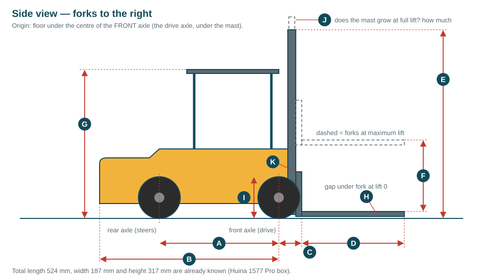
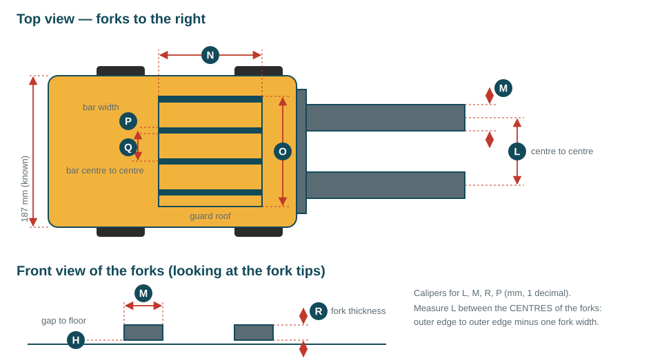
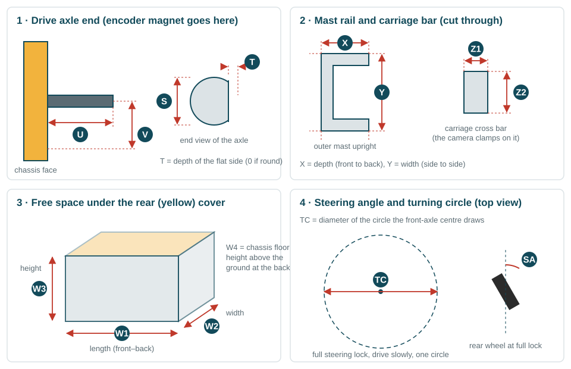
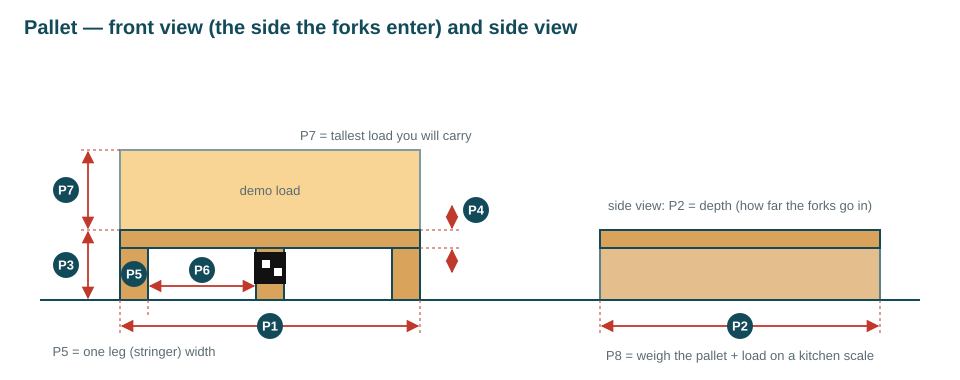

# What to measure on the forklift (ME-01, ME-02)

Every size of the forklift in the code is a **guess** right now. Only the box size of the Huina 1577 Pro
(524 × 187 × 317 mm) is real. The same numbers are used in four places:

| Where | What uses the numbers |
|---|---|
| `ai/training/forklift_rl/config.yaml` | the docking AI is trained on a forklift with these sizes |
| `robot/cad/params.yaml` | the 3D-printed mounts are drawn to fit them |
| `robot/ros2_ws/.../dimensions.yaml`, `nav2_params.yaml` | the robot model, the footprint, the turning radius |
| `robot/firmware/.../config.h` | wheelbase, steering limit, lift range, speed |

You measure; I put each number in all the right files, retrain the docking AI (about 15 minutes) and re-draw the
mounts. **You don't need to edit any code.**

## Before you start

- **Tools:** digital calipers, a tape measure, a phone protractor app, a stopwatch, a multimeter (or the INA219),
  a kitchen scale, a pen and some tape.
- **Units:** millimetres with one decimal for small parts (calipers), whole millimetres for long ones (tape).
- **Photos:** take a photo of every place you measure, with the calipers or tape visible. If a number looks
  strange later, the photo answers the question without opening the forklift again.
- **If a part is shaped differently from the drawings**, measure what makes sense and send a photo. The drawings
  are schematic; they show *which* distance, not the exact shape.
- **The drive axle is at the front (under the mast) and the steering is at the back** in the drawings. If your
  forklift is the other way round, say so — that changes the model, not only the numbers.

**Most urgent:** group 1. With only those numbers I can already retrain the docking AI.

---

## Group 1 — Body and forks (needed to retrain the AI)





| ID | What | How | Current guess |
|---|---|---|---|
| **A** | Wheelbase: front axle centre → rear axle centre | tape, between the wheel hubs, on both sides; average | 200 mm |
| **B** | Body behind the front axle: front axle centre → very back of the body | tape | 300 mm |
| **C** | Front axle centre → front face of the fork carriage (where the forks hang) | tape or calipers | 30 mm |
| **D** | Fork length: carriage face → fork tip (the flat part only) | calipers / tape | 180 mm |
| **E** | Mast height: floor → top of the mast, forks down | tape | 317 mm |
| **F** | Lift range: fork top at lowest → fork top at highest | lift fully, measure both heights from the floor, subtract | 120 mm |
| **G** | Floor → top of the overhead guard roof | tape | 245 mm |
| **H** | Gap between the floor and the fork bottom, forks fully down | calipers (depth rod) or feeler / stack of paper | 4 mm |
| **I** | Wheel diameter (front, driven wheel) | calipers across the tyre | 70 mm |
| **J** | Does the inner mast rise above E at full lift? By how much? (0 if not) | tape at full lift | 0 mm |
| **K** | Backrest height: fork top → top of the carriage backrest | calipers | 70 mm |
| **L** | Fork spacing, **centre to centre** | calipers: outer edge to outer edge, minus one fork width | 90 mm |
| **M** | Fork width (one fork) | calipers | 35 mm |
| **R** | Fork thickness | calipers | 12 mm |

## Group 2 — Steering, speed and motors (the controller and the AI need these)

| ID | What | How | Current guess |
|---|---|---|---|
| **SA** | Maximum steering angle, left and right | full lock; phone protractor on the rear wheel against the body side | 30° |
| **TC** | Turning circle | see panel 4 below: full lock, drive slowly one full circle with a pen taped under the **front-axle centre**, measure the circle's diameter. Do it left and right | ≈ 700 mm |
| **SP** | Top speed | full throttle on the stock remote over 2 m of floor, time it 3 times: speed = 2 / time | 0.45 m/s |
| **GR** | Gear ratio | mark the wheel and the axle stub; turn the wheel exactly one turn by hand; count axle-stub turns | 1 |
| **LS** | Lift speed | time the forks from lowest to highest, 3 times | ≈ 2.4 s |
| **ME-01** | Which motors are inside | for each — drive, steering, lift, side-shift: is it a DC motor or a servo? how many wires? any label/number? | — |
| **ME-02** | Motor currents | multimeter in series (or INA219) at 7.4 V: current while **running** free, and **stall** current (hold the wheel/fork for **under 2 seconds**). Drive, steering, lift | — |
| **WT** | Weight of the bare forklift | kitchen scale | — |

## Group 3 — Where the printed mounts attach



| ID | What | How | Current guess |
|---|---|---|---|
| **S** | Drive axle stub diameter (the encoder magnet cap presses on it) | calipers | 4.0 mm |
| **T** | Depth of the flat side on the axle (0 if it is round) | calipers: full diameter minus the across-the-flat size | 0.5 mm |
| **U** | Axle end → chassis face it sticks out of | calipers, depth rod | 12 mm |
| **V** | Axle centre → a flat chassis surface a small bracket could be screwed to | calipers; photo of that surface | 14 mm |
| **X**, **Y** | Outer mast upright (channel) depth and width — the slide-pot bracket clamps on it | calipers | 10 × 14 mm |
| **Z1**, **Z2** | Carriage cross bar thickness and height — the camera clamp grips it | calipers | 6 × 12 mm |
| **N**, **O** | Guard roof length and width (LiDAR sits on it) | calipers | 120 × 110 mm |
| **P**, **Q** | Guard roof bar width, and centre-to-centre distance between bars | calipers | 8 mm, 30 mm |
| **W1–W3** | Free space under the rear (yellow) cover: length × width × height — the Jetson box goes there | open the cover, calipers/tape | 150 × 160 × 75 mm |
| **W4** | Height of the chassis floor above the ground at the back | calipers | 25 mm |

## Group 4 — Pallet



| ID | What | Current guess |
|---|---|---|
| **P1** | Width (side the forks enter) | 200 mm |
| **P2** | Depth (how far the forks go in) | 200 mm |
| **P3** | Total height (floor → top of the deck) | 35 mm |
| **P4** | Top deck thickness | 8 mm |
| **P5** | Width of one leg (stringer) | 20 mm |
| **P6** | Width of one fork opening (between two legs) | 70 mm |
| **P7** | Height of the tallest load you will put on a pallet | 40 mm |
| **P8** | Weight of a pallet with its load | 250 g |

Measure P6 and the opening **height** (floor → underside of the deck) carefully: the forks plus the
fork-tip sensor clip have to fit inside with 2 mm to spare.

## Group 5 — The parts you received (check against the datasheet)

When the parts arrive, measure the boards with calipers. Each one has a bracket drawn for it, so the screw holes have to match the real board.

| Part | Measure |
|---|---|
| VL53L1X ToF board (×6) | board W × H, the 2 screw-hole centres |
| Jetson Orin Nano carrier | distance between the 4 mounting holes, hole → board corner |
| AS5600 encoder board | board size, hole centres |
| Slide potentiometer module | body L × W × H, knob travel, hole centres |
| 4-slot 18650 holder + BMS | L × W × H of each |
| E-Stop contact block | size under the panel |
| RPLIDAR C1 | hole spacing on the bottom, height of the scan window above the base |

## Group 6 — The warehouse floor (later, EN-01 … EN-08)

- The room: length × width of the floor area, where the walls are.
- Each rack: position of its front-left corner from one fixed corner of the floor, its width and depth, and the height of
  every shelf level.
- Each charger spot and each zone (inbound, outbound, staging, no-go): position and size.
- Aisle widths in front of the racks (≥ 85 cm needed) and between racks.
- A sketch on squared paper with these numbers and a photo is enough. I turn it into `warehouse_map.yaml` and the
  Gazebo world.

---

## Sending the numbers back

Copy this block, fill it in, and send it with the photos. Leave a line empty if you couldn't measure it.

```text
forklift: Huina 1577 Pro    drive axle at: front / back    steering at: front / back

A  wheelbase                     =     mm
B  body behind front axle        =     mm
C  front axle -> carriage face   =     mm
D  fork length                   =     mm
E  mast height                   =     mm
F  lift range                    =     mm   (lowest    mm, highest    mm)
G  guard roof top                =     mm
H  fork gap to floor             =     mm
I  wheel diameter                =     mm
J  mast rise at full lift        =     mm
K  backrest height               =     mm
L  fork spacing centre-centre    =     mm
M  fork width                    =     mm
R  fork thickness                =     mm

SA steering angle left / right   =     ° /     °
TC turning circle left / right   =     mm /     mm
SP 2 m times                     =     s,     s,     s
GR axle turns per wheel turn     =
LS lift times                    =     s,     s,     s
WT forklift weight               =     g
motors (type, wires, label):  drive:            steering:            lift:            side-shift:
currents running / stall (A): drive:     /      steering:     /      lift:     /

S  axle diameter = mm   T flat = mm   U axle end->face = mm   V axle->flat surface = mm
X x Y mast rail = x mm   Z1 x Z2 carriage bar = x mm
N x O roof = x mm   P bar width = mm   Q bar pitch = mm
W1 x W2 x W3 rear space = x x mm   W4 rear floor = mm

P1 = mm  P2 = mm  P3 = mm  P4 = mm  P5 = mm  P6 = mm  opening height = mm  P7 = mm  P8 = g
```
