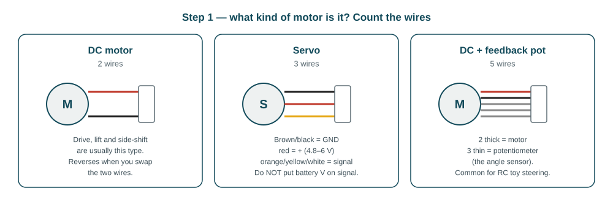
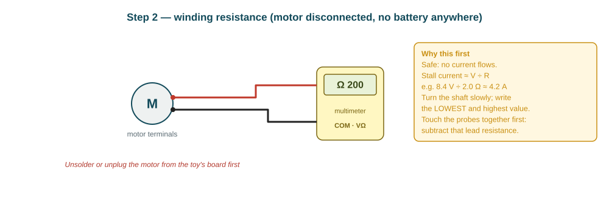
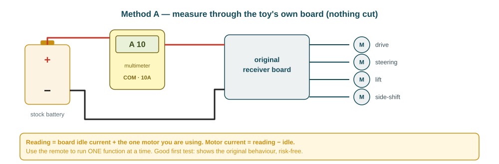
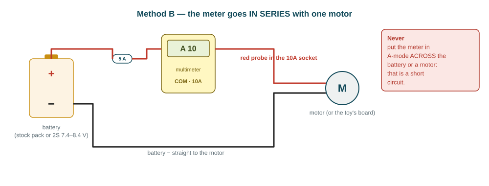
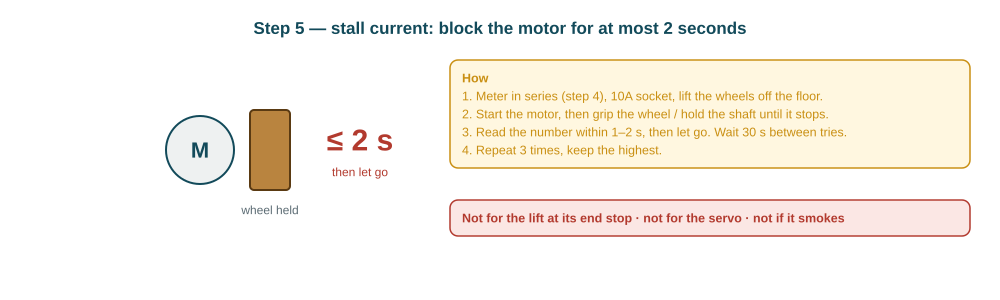

# Measuring the forklift's motors (ME-01, ME-02)

This guide shows how to find out **what each motor is** and **how much current it draws**, with a normal
multimeter. You measure; I use the numbers to choose the motor drivers, check the fuse and the current sensor,
and set the speed values in the firmware. Printable copy: [motor-measurements.pdf](motor-measurements.pdf).

**There are four motors to test:** drive, steering, lift and side-shift.
The whole job takes about one to two hours.

## What the numbers decide

| Measurement | What I decide with it |
|---|---|
| Motor type (DC / servo / DC + pot) | How the ESP32 drives it, and whether steering needs a position sensor |
| Running current | Driver: the planned MX1508 handles **1.5 A continuous** per motor |
| Stall current | Driver: MX1508 peak is **2.5 A**. Above that, the drive motor gets the **BTS7960** (15 A) from the parts list |
| Total current, all running | The INA219 current sensor: its stock shunt reads only **up to 3.2 A**; above that it gets a 0.01 Ω shunt |
| Currents + Jetson (≈ 2–2.5 A) | Whether the **5 A main fuse** and the wiring are enough |
| Speeds and times | Firmware values: speed at full power, gear ratio, lift speed (`config.h`) |
| Steering servo current | Whether the 5.1 V supply can feed the servo when it pushes against a stop |

---

## Before you start

**Tools:**

- A multimeter with a **10 A** current range.
- An inline **5 A fuse**, crocodile clips and insulating tape.
- A stopwatch and a tape measure.
- A charged stock battery, and the 2S pack if you have it.
- Your phone, for photos.

**Safety rules (read once):**

1. **The current range goes in SERIES only.** In A-mode the meter is almost a wire: never touch its probes across
   the battery or across a motor.
2. **Use the 10A socket** for every current test (start there, even if the reading is small), and put the 5 A fuse in
   the plus wire.
3. **Stall for 2 seconds at most**, then let go and wait 30 s. Stalled motors heat up fast.
4. **Never stall the lift against its end stop or the steering against its lock.** Gears and servos break.
5. **Lift the wheels off the floor** for every drive test that isn't marked "on the floor".
6. **Keep fingers clear of the forks and gears.** If anything smells hot or smokes: disconnect the battery first, then look.
7. **Write the battery voltage next to every current reading**, because current changes with voltage.

---

## Step 1 — identify each motor

Open the forklift and follow the wires from each motor to the board. Take a photo of every motor and its label.



**For each motor, write down:**

- Its job.
- The number of wires and their colours.
- Any printed label or number, such as "RF-300" or "N20".
- Where it sits.

If the steering has 3 wires, it is a servo. Then also measure the voltage between its red and brown/black wire
with the toy switched on (V-DC mode, probes **across** the two wires — this is a voltage test, so across is correct).

## Step 2 — winding resistance (safe, no power)

Unplug or unsolder one motor from the toy's board. There must be **no battery connected anywhere**.



1. Set the meter to Ω (200 range) and touch the probes together. Write this lead resistance down.
2. Put the probes on the motor's two terminals, then turn the shaft slowly by hand. Write the **lowest** and **highest** reading.
3. Subtract the lead resistance from both readings.

This gives a safe estimate of the stall current before you ever block a motor:
**stall ≈ battery voltage ÷ lowest resistance.** For example, 8.4 V ÷ 2.0 Ω ≈ 4.2 A.

This step is for the two-wire DC motors only. For a 5-wire steering, measure the 3 thin wires: end to end (the
potentiometer's full value), then the middle wire to each end with the steering at left lock, centre and right lock.

## Step 3 — Method A: currents through the toy's own board

The easiest and safest start. Nothing is cut: the meter goes in the battery's plus wire, and you use the remote.



1. Switch on, touch nothing on the remote. Write the **idle** current.
2. Run **one** function at a time with the remote and write the steady current:

    - drive forward, wheels in the air;
    - drive forward on the floor;
    - steering, full left and full right;
    - lift up and down, empty, and with the heaviest pallet + load;
    - side-shift left and right.

3. **Motor current = reading − idle current.**
4. Also write the battery voltage while each function runs: switch the meter to V and measure across the battery terminals.

## Step 4 — Method B: currents straight to one motor

This gives the real numbers at our battery voltage. Disconnect the motor from the toy's board and wire it as below:
**battery + → 5 A fuse → meter (10A socket) → motor → battery −**. To reverse, swap the two wires at the motor.



**For the drive, lift and side-shift motors:**

| Reading | How |
|---|---|
| **No-load current** | Wheels in the air (or lift empty), wait 3 s, read |
| **Running current** | Drive: on the floor, pushing the forklift's own weight. Lift: raising the heaviest pallet. Read the steady value |
| **Start peak** (if your meter has MAX / peak hold) | Press MAX, then connect the motor; read the highest value |

Use the stock battery first. If you have the 2S pack (7.4–8.4 V), repeat with it: the motors will run faster and
draw more current, and that's the voltage they will see in the finished forklift.

## Step 5 — stall current (drive motor only, carefully)



Only the **drive motor** needs a real stall test. It decides MX1508 vs BTS7960.

- **Lift and side-shift:** use the estimate from step 2.
- **Steering servo:** measure the current at full lock in step 3. That is its stall.

If step 2 already predicts more than 5 A at 8.4 V, skip the real stall test and tell me. The answer is
"BTS7960" either way.

## Step 6 — speeds and times

| ID | What | How |
|---|---|---|
| SP | Top speed | Full throttle over 2 m of floor, time it 3 times: speed = 2 ÷ time |
| GR | Gear ratio | Mark the wheel and the motor shaft or axle stub. Turn the wheel once by hand and count the shaft turns |
| LT | Lift time | Forks lowest → highest, empty and with the heaviest load, 3 times each |
| DT | Lowering time | Highest → lowest, empty |
| SS | Side-shift | Distance from far left to far right (mm) and the time it takes |
| ST | Steering time | Full left → full right, time it |

## Step 7 — heat check

Drive back and forth for 5 minutes, then touch each motor:

- **Warm:** fine.
- **Too hot to hold for 3 s:** the motor is overloaded. Write it down, because it changes the driver choice.

---

## Results form

Copy this block, fill it in, and send it back with the photos. Leave a line empty if you couldn't measure it.

```text
Battery used:  stock ___ V (label: ______)    2S pack ___ V     meter model: ______
Lead resistance (probes touching) = ___ Ω

DRIVE MOTOR      type: DC / other ___   wires: ___ colours: ______   label: ______
  resistance          lowest ___ Ω   highest ___ Ω
  Method A (board)    idle ___ A   wheels up ___ A   on floor ___ A   at ___ V
  Method B (direct)   no-load ___ A   on floor ___ A   start peak ___ A   at ___ V
  stall (≤ 2 s)       ___ A ___ A ___ A   at ___ V
  heat after 5 min    warm / hot

STEERING         type: DC / servo / DC+pot   wires: ___ colours: ______   label: ______
  servo: voltage red-to-brown with toy on = ___ V
  current at full left ___ A   full right ___ A   (Method A, minus idle)
  5-wire: pot end-to-end ___ Ω   middle-to-end at left ___ Ω  centre ___ Ω  right ___ Ω

LIFT MOTOR       type: ___   wires: ___   label: ______
  resistance          lowest ___ Ω   highest ___ Ω
  Method A            up empty ___ A   up loaded ___ A   down ___ A
  Method B            no-load ___ A   up loaded ___ A   at ___ V

SIDE-SHIFT       type: ___   wires: ___   label: ______
  resistance          lowest ___ Ω   highest ___ Ω
  Method A            left ___ A   right ___ A

SPEEDS
  SP 2 m times  ___ s  ___ s  ___ s        GR shaft turns per wheel turn = ___
  LT lift empty ___ s  ___ s  ___ s        LT lift loaded ___ s  ___ s  ___ s
  DT lowering   ___ s                      SS side-shift ___ mm in ___ s
  ST steering left → right ___ s
```

## What happens next

When I have the form I will:

1. **Choose the drivers:** MX1508 for every motor with running ≤ 1.5 A and stall ≤ 2.5 A; BTS7960 for any motor above that.
2. **Check the INA219 shunt** (0.1 Ω up to 3.2 A, or 0.01 Ω) and the 5 A fuse, against all motors plus the Jetson.
3. **Set the firmware values** in `config.h`: speed at full power, gear ratio, lift speed.
4. **Update the wiring guide and the parts list** if a driver changes.

The lift's minimum power and the PID gains are tuned later on the bench (test T-03 and T-04), once our own drivers are connected.
