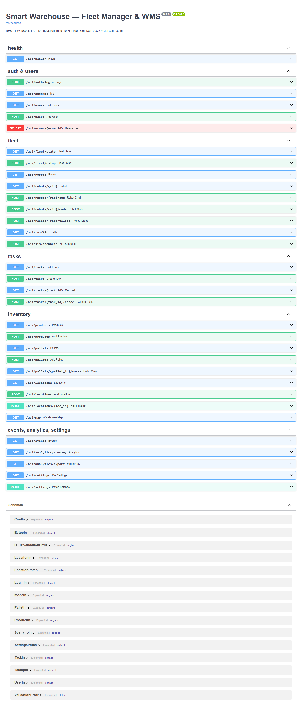
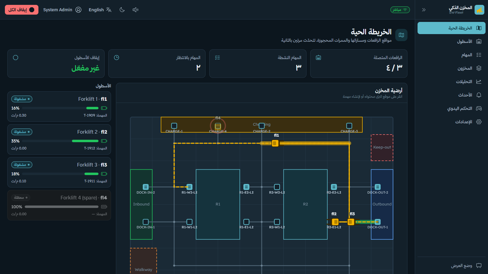
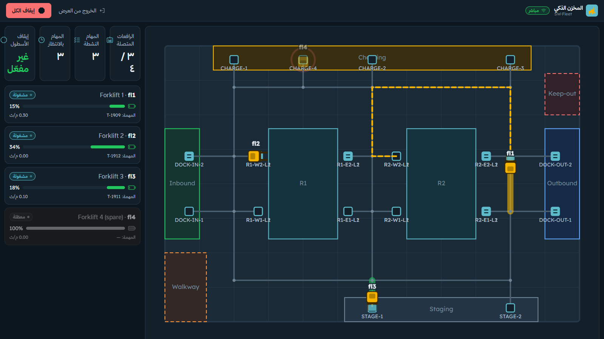
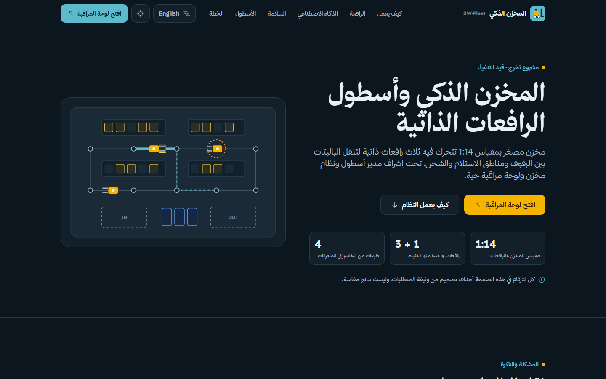

# Chapter 3 — System design

<!-- Sources: docs/01-architecture.md, 02-api-contract.md, 03-mqtt-contract.md, 04-data-model.md, 05-design-system.md,
     06-backend.md, 07-dashboard.md, 09-mobile.md, 12-firmware.md, 13-ros2.md, 00-sources/system-requirements.md.
     Dimensions marked PLACEHOLDER in the code are design values until the first forklift is measured (ME-01). -->

## 3.1 Layered architecture

The system has four layers. Each layer talks only to its neighbours, and each one keeps the forklift safe on its own
if the layer above it fails (NFR-08).
<!-- docs/01-architecture.md "Layers"; docs/00-sources/system-requirements.md §9 -->

```
 Layer 4 · Server (LAN laptop / mini PC)
   FastAPI fleet manager (allocation, lane-graph A*, traffic locks, battery policy)
   WMS (PostgreSQL / SQLite) · REST /api + WebSocket /ws/live (2 Hz) · fleet simulator
   Mosquitto MQTT broker · React dashboard · Flutter floor app · public landing page
        ▲  Wi-Fi 5 GHz · MQTT + JSON  (task / cmd / estop ↓   state / task_status / event ↑   traffic ↕)
 Layer 3 · Jetson Orin Nano Super ×3 — ROS 2 Humble
   mission (behaviour tree + MQTT fleet client) · navigation (slam_toolbox, EKF, Nav2)
   perception (ArUco, YOLO) · rl (docking policy) · safety supervisor
        ▲  USB · micro-ROS
 Layer 2 · ESP32-S3 — FreeRTOS firmware
   Core 1 (1 kHz): safety state machine (ToF, limits, E-Stop, 500 ms watchdog), drive PID, lift PID
   Core 0: micro-ROS client, IMU, status LEDs
        ▲
 Layer 1 · sensors, motors and a hardware E-Stop that cuts motor power without software
```

**Figure 3.1** — System layers (redraw for the thesis from `docs/01-architecture.md`).

Two design decisions shape everything else:

1. **The server does not depend on ROS.** Robots and server exchange plain JSON over MQTT, so the server, dashboard
   and app were developed and demonstrated with a built-in fleet simulator before any forklift existed. Switching a
   robot from simulated to real is one flag in the map file (`simulated: false`).
   <!-- docs/01-architecture.md "Why the server is independent of ROS" -->
2. **All decision logic is plain code without hardware or middleware dependencies.** The firmware's safety, control
   and kinematics live in a C++17 library with no Arduino headers; the ROS 2 packages keep their logic in modules
   that do not import `rclpy`. Both are unit-tested on a laptop (Chapter 6); the hardware-facing parts are thin.
   <!-- docs/12-firmware.md §1; docs/13-ros2.md intro -->

## 3.2 Hardware

### 3.2.1 Forklift platform

The base is the Huina 1577 Pro RC forklift (52.4 × 18.7 × 31.7 cm). The chassis, motors and lift mechanism are kept;
the RC receiver and battery are replaced. Mounts are 3D-printed: LiDAR on the overhead guard (360° view above the mast
and loads), camera on the fork carriage pitched 15–25° down (it moves with the lift), six ToF mounts (front under the
forks, two front corners, two sides, rear), an AS5600 magnetic encoder on the drive axle, a linear potentiometer and
two limit switches on the mast, a TCRT5000 reflective sensor on each fork tip, a ventilated electronics box, the
battery low at the rear as a counterweight, and the E-Stop on top at the rear. The add-ons should weigh ≤ 700 g.
<!-- docs/00-sources/system-requirements.md §2 ME-01..ME-14 -->

The forklift steers with its **rear wheels** (to be confirmed by ME-01), which matters for kinematics, for the ToF
logic (the tail swings out in a turn) and for the planner (minimum turning radius).
<!-- docs/12-firmware.md §4 FW-01; docs/13-ros2.md §1 key values (min turning radius 0.35 m, PLACEHOLDER) -->

### 3.2.2 Electronics and parts

| Group | Parts (per forklift) | Cost (IQD) |
|---|---|---|
| Compute | Jetson Orin Nano Super 995,000 · NVMe SSD 66,000 · ESP32-S3 Zero 9,250 | 1,070,250 |
| Sensing | RPLIDAR C1 185,000 · Camera Module 3 68,000 · 6 × VL53L1X 99,000 · MPU9250 18,500 | 370,500 |
| Fork | AS5600 · 2 × TCRT5000 · 2 × limit switch · slide potentiometer · TCA9548A I²C mux | 14,500 |
| Power | 4 × 18650 cells · 2S BMS · holder · XL4015 buck · INA219 · TXS0108E level shifter | 36,750 |
| Actuation | 2 × MX1508 H-bridge · MG90S servo · E-Stop · WS2812 ring · buzzer | 15,250 |
| **Total** | | **1,507,250** |

<!-- landing/src/content/bom.ts (grouped from docs/00-sources/parts-bom.pdf; bom.test.ts checks the sum) -->
[CHECK: the parts list is not complete — docs/14-hardware-build.md §5 lists items still to buy, several of which
block the first power-up (12 V boost converter ≥ 30 W for the Jetson, a 0.01 Ω INA219 shunt, fuse, main switch, a
second E-Stop contact block, capacitors, connectors). Add their cost when bought.]

Mounts are generated with CadQuery from a single parameter file (`robot/cad/params.yaml`, 41 values still marked
PLACEHOLDER); wiring, the power tree and the pin map are in [docs/14-hardware-build.md](../14-hardware-build.md).
<!-- docs/14-hardware-build.md §1, §5 -->

**Power tree.** A 2S2P Li-ion pack (7.4 V nominal, 6.0–8.4 V, 7000 mAh) feeds a BMS, a 5 A fuse and a main switch,
then splits into three branches: a 12 V boost converter for the Jetson (its DC jack accepts 9–20 V only), a 5.1 V buck
converter for the ESP32, sensors and LEDs, and the motor drivers **through the normally-closed E-Stop**, which cuts
the motors but not the computers, so they keep logging and reporting. The design power budget is ≈ 15 W average and
≈ 36 W peak; 52 Wh gives ≈ 3 h at the average load and at least 45 min at peak (NFR-05). These are design estimates
until test T-01.
<!-- docs/00-sources/system-requirements.md §3 power budget, EL-01..EL-05 -->

## 3.3 Firmware (ESP32-S3)

The firmware (PlatformIO, FreeRTOS) separates safety from communication by CPU core so that a slow network can never
delay a safety reaction.
<!-- docs/12-firmware.md §2 -->

| Task | Core / rate | Role |
|---|---|---|
| `safety_task` | 1 / 1 kHz, highest priority | E-Stop, ToF, fork height, battery, link times → safety state machine → speed limit. Only task on the hardware watchdog (1 s → reboot). |
| `motor_pid_task` | 1 / 1 kHz | Speed from the AS5600, drive PID with feed-forward, rear-steer Ackermann → servo, odometry, lift controller, limit switches. Brakes by itself if the safety output is > 5 ms old. |
| `tof_task` | 1 / 50 Hz | Six VL53L1X through the TCA9548A; re-initialises dropped sensors. |
| `imu_task` | 0 / 100 Hz | MPU9250 + Madgwick filter. |
| `microros_task` | 0 / event | ROS topics, agent reconnect, parameters. |
| `status_task` | 0 / 10 Hz | INA219 battery, LED ring, buzzer. |

**Safety state machine (FW-08).** States BOOT → IDLE → ACTIVE ↔ SLOW → STOP → SAFE / ESTOP, evaluated every 1 ms with
ESTOP first. ESTOP is latched: releasing the button does nothing until an explicit reset. SAFE is entered on heartbeat
loss (> 500 ms), a stale non-zero velocity command, battery < 8 % or an encoder fault; the speed then ramps to zero
(0.3 m/s → 0 in 60 ms). Before the first Jetson heartbeat the robot stays IDLE and ignores velocity commands.
<!-- docs/12-firmware.md §3 -->

**Speed caps.** ToF readings count only in the direction of motion: < 40 cm caps speed at 30 % of 0.3 m/s,
< 15 cm stops in the same 1 ms tick; a stale or failed leading sensor also stops (fail-safe). During docking the
front-centre sensor (which sees the pallet) is ignored while the corners still stop and speed is ≤ 0.1 m/s (SF-03).
Forks above 50 mm cap speed at 0.1 m/s (SF-08). All caps scale linear and angular speed together so the path's
curvature is kept.
<!-- docs/12-firmware.md §3 bullets -->

**Kinematics and control.** Rear-wheel Ackermann about the driven front axle: ω = −v·tan δ / L, δ clamped to ± 30°.
Odometry is integrated at 1 kHz and published at 50 Hz. The drive speed loop is feed-forward + PI (kp 6, ki 80, tuned
on a first-order motor model with ± 25 % gain error); the lift loop is PI with a ± 1.5 mm dead-band. The wheelbase
L = 0.20 m is a placeholder until ME-01.
<!-- docs/12-firmware.md §4 -->

**Same binary for every forklift.** The robot id (`fl1` …) is stored in NVS and becomes the micro-ROS namespace
(FW-12).

## 3.4 Robot software (ROS 2 on the Jetson)

Nine ROS 2 Humble packages run on each Jetson under the namespace `/fl1`, `/fl2` or `/fl3`.
<!-- docs/13-ros2.md §1 -->

| Package | Role |
|---|---|
| `forklift_description` | URDF/Xacro with sensor frames; full TF tree `map → odom → base_link → {laser, camera, imu, fork}` |
| `forklift_interfaces` | Messages (ForkState, SafetyState, FleetStatus, PalletPose), service Reset, actions Lift, Dock, MoveTask |
| `forklift_bringup` | One launch file, YAML configuration, rosbag recording, systemd autostart |
| `forklift_navigation` | slam_toolbox, EKF (50 Hz), Nav2 with Smac Hybrid-A* (Reeds-Shepp) and Regulated Pure Pursuit (20 Hz), keepout and speed filter masks |
| `forklift_perception` | ArUco detection + solvePnP, 5-sample moving average, automatic initial pose from a charger marker |
| `forklift_safety` | The supervisor: the only node that publishes `cmd_vel` to the ESP32 |
| `forklift_mission` | Behaviour tree and MQTT fleet client implementing the robot ↔ server contract |
| `forklift_rl` | Docking: the RL policy (ONNX Runtime; TensorRT on the Jetson planned) with the classical controller as fallback |
| `forklift_sim` | Gazebo world generated from the warehouse map (skeleton) |

**Every command passes the supervisor.** Nav2, the docking server and manual teleoperation publish to separate
topics (`cmd_vel_nav`, `cmd_vel_dock`, `cmd_vel_teleop`); the supervisor selects the source allowed by the current
mode, clamps speed and acceleration (0.3 m/s; 0.1 m/s with forks above 50 mm or while docking), applies the ToF rules
by direction and person-distance rules (< 1 m slow, < 0.5 m stop), and sends a 10 Hz heartbeat to the ESP32. On server
loss for more than 3 s the robot finishes its current lane and stops (SF-05).
<!-- docs/13-ros2.md §1 key values, §2 graph -->

The approach to a pallet is split: Nav2 brings the forklift to within 5 cm / 5° of a pre-dock pose, and the docking
module (Chapter 4) performs the last ≈ 40 cm.
<!-- docs/00-sources/system-requirements.md §7 NV-11 -->

**Figure 3.2** — Per-robot node and topic graph (redraw the Mermaid diagram in `docs/13-ros2.md` §2).

## 3.5 Robot ↔ server contract (MQTT)

<!-- docs/03-mqtt-contract.md -->

| Topic | Direction | QoS | Purpose |
|---|---|---|---|
| `wh/fl/{id}/state` | robot → server, 2 Hz | 0 | Pose, mode, battery, safety state, current task |
| `wh/fl/{id}/task` | server → robot | 1 | Move-pallet task with from/to and the planned route |
| `wh/fl/{id}/task_status` | robot → server | 1 | accepted → to_pickup → picking → to_drop → dropping → done / failed |
| `wh/fl/{id}/cmd` | server → robot | 1 | pause, resume, cancel, go_charge, reset, mode |
| `wh/fl/{id}/teleop` | server → robot, ≤ 10 Hz | 0 | Manual drive (clamped, dead-man) |
| `wh/fl/{id}/event` | robot → server | 1 | Safety and error events |
| `wh/traffic/{from}--{to}` | both | 1 | Lane request / grant / deny / release |
| `wh/fleet/estop` | server → all | 1, **retained** | Fleet emergency stop |

Every message carries a per-sender sequence number and a UTC timestamp. Each robot has its own broker account and an
ACL that lets it publish only its own topics. A robot's Last Will (`{"online": false}`) marks it offline at once if it
drops; the retained E-stop means a robot that reconnects learns the fleet state immediately. JSON Schemas for every
payload are in `docs/schemas/`.

## 3.6 Server: fleet manager and WMS

The server is a Python 3.11 FastAPI application with SQLAlchemy over PostgreSQL (SQLite in development) and Alembic
migrations. A 10 Hz fleet loop runs allocation, traffic and the simulator; a 2 Hz loop broadcasts snapshots on the
WebSocket.
<!-- docs/06-backend.md "Modules"; plan.md B7 (Alembic) -->

- **WMS tables:** locations, pallets, products, robots, tasks, events, inventory moves, traffic waits, users,
  settings. A pallet's location changes only when the robot reports `done`, in the same database transaction that
  writes the inventory move (SV-09).
  <!-- docs/04-data-model.md -->
- **REST API and WebSocket:** JWT authentication with three roles (admin, operator, viewer); OpenAPI documentation at
  `/docs`; `/ws/live` pushes snapshots, task, inventory and event frames.
  <!-- docs/02-api-contract.md; docs/10-traceability.md SV-07, SV-08, SV-10 -->
- **Safety on the server:** fleet E-stop (effective on the next 10 Hz tick and retained over MQTT), battery policy
  (low → charge, critical → safe stop), teleoperation clamping with a 0.5 s dead-man, offline detection with a 3 s
  heartbeat timeout.
  <!-- docs/10-traceability.md SF-05, SF-07, SF-11; docs/03-mqtt-contract.md -->
- **Simulator (SV-06):** fake robots drive the same lane graph and locks at 0.3 m/s (0.1 m/s on the final approach
  and with raised forks), spend 3 s per pick/drop, drain and recharge, and can be disturbed by admin scenarios:
  `person`, `obstacle`, `drain_battery`, `disconnect`, `random_tasks`.
  <!-- docs/06-backend.md "Simulator" -->

Traffic control and task allocation are the subject of Chapter 5.


**Figure 3.3** — OpenAPI documentation of the server.

## 3.7 User interfaces

All three interfaces share one design system: an industrial palette (slate navy `ink`, steel teal `primary`, and a
forklift-yellow `lift` signature), semantic tokens that flip between light and dark themes, Thmanyah Sans / Serif for
Arabic and Lexend for English, Phosphor icons, and Arabic right-to-left by default with English available. Danger red
is reserved for the E-stop, faults and destructive actions.
<!-- docs/05-design-system.md -->

**Control-room dashboard (React 19 + TypeScript + Vite).** Ten screens map to UI-01 … UI-10: live map, fleet,
tasks, inventory, analytics, events, manual control (browser Gamepad API), settings with the simulator panel, and a
kiosk mode for a large screen. A «إيقاف الكل / Stop all» button is visible on every screen.
<!-- docs/07-dashboard.md §1 -->


**Figure 3.4** — Dashboard live map: lane graph, locations, forklifts and reserved segments.


**Figure 3.5** — Kiosk mode for the defence screen.

**Floor app (Flutter, Android and iOS).** For people in the aisles: a press-and-hold STOP ALL on every screen, live
fleet cards, safety alerts with vibration, a mini map, creating and cancelling move tasks, pallet lookup, and manual
drive that sends commands only while a dead-man button is held.
<!-- docs/09-mobile.md §1, §2 -->
[CHECK: no floor-app screenshots exist in docs/media yet — add them before printing.]

**Landing page.** A static bilingual site that presents the project; numbers on it are labelled as design targets
until tests pass.
<!-- landing/README.md "Honesty" -->


**Figure 3.6** — Project landing page (Arabic, dark theme).

## 3.8 Safety by layers — summary

| Layer | Mechanism | Works without |
|---|---|---|
| Hardware | NC E-Stop cuts motor power (SF-01) | all software |
| ESP32 | ToF stop/slow by direction, raised-fork cap, 500 ms watchdog, latched ESTOP (SF-02..SF-04, SF-08, SF-09) | the Jetson, the network |
| Jetson | Supervisor clamps Nav2, RL and teleop; person detection; server-loss behaviour (SF-03, SF-05..SF-07) | the server |
| Server | Lane locks, fleet E-stop ≤ 1 s, battery policy, event log (SF-09..SF-11, SF-13) | — |

<!-- docs/00-sources/system-requirements.md §9 -->
