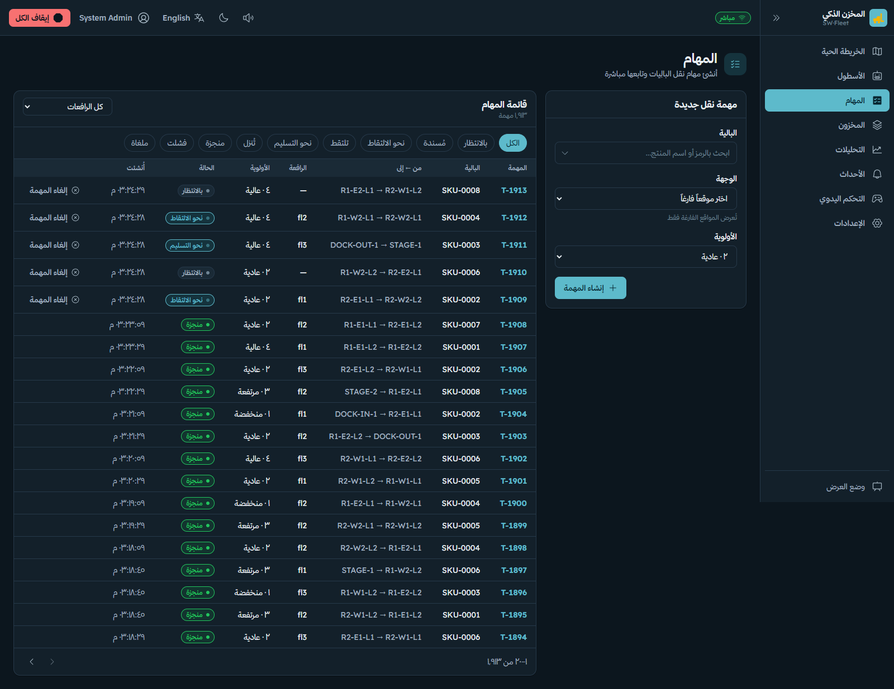
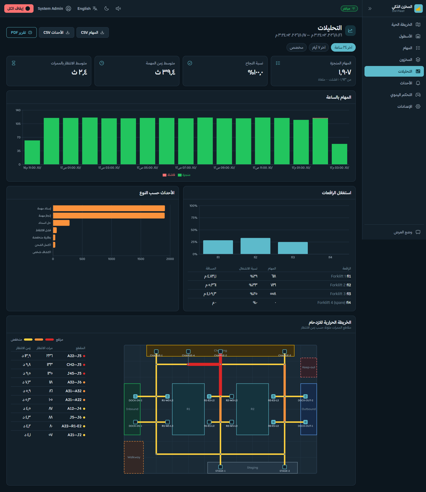

# Chapter 5 — Fleet management

<!-- Sources: docs/06-backend.md, docs/04-data-model.md, docs/03-mqtt-contract.md, docs/10-traceability.md,
     code/backend/app/fleet/{graph,traffic,allocator,manager}.py.
     TODO(allocation study): docs/18-allocation-study.md is being written in a parallel session. When it exists,
     replace §5.5 "Allocation results" with its method and numbers and cite it. -->

## 5.1 Requirements

The fleet manager must assign every move order to an available forklift (FR-02), prevent forklift–forklift
collisions in the aisles by giving each lane segment to one robot at a time (FR-08, SF-10), detect and resolve
deadlocks (SV-03), re-assign tasks when a robot fails (SV-04), send robots to charge (FR-09, SV-05), and compare a
simple allocation rule with an optimised one by task completion time (AI-08).
<!-- docs/00-sources/system-requirements.md §1, §8, §9, §11 -->

## 5.2 The lane graph

The floor is described once in `code/backend/app/warehouse_map.yaml`: nodes, edges (lanes), zones, locations and
robots. The current map is a 6 m × 4 m floor with a bottom corridor at y = 0.6 m, a top corridor at y = 3.4 m, three
aisles at x = 1.0 / 3.0 / 5.0 m, two racks with 16 locations, 2 inbound and 2 outbound docks, 2 staging spots and 4
chargers. All coordinates are placeholders until the real floor is measured; changing the floor means editing only
this file.
<!-- docs/04-data-model.md "Lane graph" -->

**Spur nodes.** Every rack slot, dock and charger is a dead-end *spur* node off an aisle node. A* never routes
*through* a spur, so a robot that is docking or waiting at a station never blocks a through route (NV-11).
<!-- docs/01-architecture.md "Key decisions"; docs/06-backend.md graph.py -->

**Routes.** A* on the lane graph with Euclidean edge lengths, optionally avoiding a set of blocked nodes (used for
detours, §5.4). On the robot, Nav2 drives each lane; the server's graph decides *which* lanes (NV-09).
<!-- code/backend/app/fleet/graph.py; docs/13-ros2.md mission -->

**Adding a robot** is one line in the `robots:` list (NFR-09); the spare `fl4` is defined but disabled.
<!-- docs/10-traceability.md NFR-09 -->

## 5.3 Traffic locks

Two kinds of resources exist: every **node** and every **edge** (lane, undirected). A robot standing on node A that
wants to drive to B must hold the lock on edge A–B **and** on node B before it moves. On arrival it releases A and the
edge and keeps B.
<!-- code/backend/app/fleet/traffic.py module docstring -->

**All-or-nothing acquisition.** `try_acquire(robot, [edge, node])` takes either all requested resources or none.
If any is held by another robot, the request fails, nothing is taken, and the robot is recorded as *waiting for*
those resources. Because a robot never holds part of what it needs for its next step, two robots can never meet
head-on in a lane, and the *hold-and-wait* condition for deadlock is removed for a single step.
<!-- traffic.py try_acquire -->

For real robots the same protocol runs over MQTT: before each lane the robot publishes `request` on
`wh/traffic/<from>--<to>`, waits for its own `grant`, re-requests every 500 ms after a `deny`, and publishes `release`
on arrival.
<!-- docs/03-mqtt-contract.md "Traffic" -->

The dashboard draws every held edge coloured by robot, so the audience can see the reservations live.

**Figure 5.1** — Reserved lane segments per robot on the live map.

## 5.4 Deadlock detection and resolution

All-or-nothing locking prevents head-on meetings, but robots that each hold their *current* node can still wait for
each other in a cycle (for example three robots around a loop). The manager therefore checks for deadlock every
fleet tick:

1. **Detection.** Build the wait-for graph — robot R → the robots holding the resources R waits for — and search it
   with depth-first search for a cycle.
   <!-- traffic.py find_deadlock -->
2. **Resolution by detour.** Robots in the cycle are ranked: idle robots first, then by task priority (lowest
   first). For each in turn, plan a new A* route to its goal that avoids the nodes it is blocked by. The detour is
   accepted only if its **first step is free**; otherwise two blocked detours could alternate forever.
3. **Resolution by back-off.** If no robot has a free detour, the lowest-ranked robot that can, backs off to a free
   neighbour — an aisle node first, else an empty spur nobody is heading to, else any empty spur — and re-plans from
   there.
4. **Stuck waits.** Independently of cycles, a robot that has waited more than **6 s** behind a robot that is stopped
   (paused, error, offline) is re-routed the same way.

Each resolution writes a `deadlock_resolved` event to the log.
<!-- code/backend/app/fleet/manager.py _resolve_traffic, _reroute_one; STUCK_REROUTE_S = 6.0 -->

The back-off step was added after stress testing: before it, long runs could gridlock; after it, **10 runs × 1
simulated hour with 3 robots, continuous random tasks and a 5 % pickup-failure rate showed no gridlock.**
<!-- docs/06-backend.md "Verification so far" (stress, not in CI) -->

## 5.5 Task allocation

**Availability.** A robot can take a task if it is enabled, online, idle, has no task, has not been asked to charge,
is above the low-battery threshold, and is not dwelling at a station.
<!-- manager.py _available -->

**Cost matrix.** Up to 20 queued tasks, ordered by priority and then age (SV-01), form the rows; available robots form
the columns. The cost is the A* path length from the robot's current (or next held) node to the task's pickup node;
unreachable pairs cost ∞.
<!-- manager.py _allocate -->

**Two strategies, switchable at run time (setting `allocation_strategy`):**

| Strategy | Rule | Complexity |
|---|---|---|
| `nearest` (v1) | In priority order, each task takes the cheapest still-free robot | O(T·R) |
| `hungarian` (v2) | Minimum total travel over all task–robot pairs (Kuhn–Munkres) | O(n³) |

<!-- code/backend/app/fleet/allocator.py -->

The greedy rule is what AI-08 calls the first version; the Hungarian method is the optimised version. Greedy
allocation can give a nearby robot to the first task in the queue even when another task is right next to it, forcing
a second robot to cross the warehouse; the optimal assignment avoids this.

### Allocation results (preliminary)

In the fleet simulator's stress runs (3 robots, continuous random tasks, 1 simulated hour per run, 10 runs), Hungarian
allocation finished **≈ 300 tasks/h** against **≈ 210 tasks/h** for the nearest rule.
<!-- docs/06-backend.md "Verification so far"; plan.md Track D -->

This is a **candidate** result: it was measured on the placeholder map with simulated robot speeds and has not been
reported with run-to-run variation. It must be re-measured on the real map with real robot speeds (plan.md Track D).
[CHECK: replace this subsection with docs/18-allocation-study.md when that study is finished — method, number of
runs, mean ± spread, and mean task completion time as AI-08 asks.]

## 5.6 Task lifecycle and WMS consistency

A task moves through `queued → to_pickup → picking → to_drop → dropping → done | failed | cancelled`. The pallet is
`reserved` while its task is queued or assigned and `in_transit` once lifted. **The WMS moves the pallet only when the
robot reports `done`, in one database transaction with the inventory-move record (SV-09)**, so the inventory can never
show a pallet in two places or in a place it never reached.
<!-- docs/04-data-model.md tasks, pallets; docs/03-mqtt-contract.md task flow -->

**Figure 5.2** — Task list with live status.

## 5.7 Failures and battery

| Situation | Server reaction | Requirement |
|---|---|---|
| Robot goes offline (Last Will or no state for 3 s) | Marked offline at once; a task not yet lifted is re-queued for another robot; a loaded robot keeps its task and waits for an operator reset | SV-04, SF-05, CM-03 |
| Battery below the low threshold | No new tasks; sent to a charger | FR-09, SF-09 |
| Battery critical | Safe stop, task re-queued | SV-05, SF-09 |
| Fleet E-stop | All robots frozen on the next 10 Hz tick (≤ 100 ms); retained MQTT message for real robots | SF-11 |
| Person / obstacle (simulated) | Stop for 4 s / 30 % speed for 3 s, then continue | FR-07 |

<!-- docs/03-mqtt-contract.md "Last Will"; docs/06-backend.md "Simulator"; docs/10-traceability.md SF-05, SF-09, SF-11 -->

## 5.8 Analytics

The analytics screen reports completed tasks, success rate, mean task time, mean lane wait, tasks per hour, per-robot
utilisation, a congestion heat map from recorded lane waits, and events by code, with CSV export (FR-11, UI-05).
<!-- docs/07-dashboard.md analytics row; docs/04-data-model.md traffic_waits -->

**Figure 5.3** — Analytics with the congestion heat map.

## 5.9 What is verified and what is not

Verified in the backend test suite: three robots × nine concurrent tasks with an invariant checked every tick that no
two robots share a lock or a node; all-or-nothing locking and deadlock detection; both allocators; disconnect and
re-queue; fleet E-stop; battery policy. The real-robot path over MQTT was tested end to end with a reference robot
client against a Python broker; not yet with Mosquitto ACLs or with real and simulated robots sharing lanes.
<!-- docs/06-backend.md; docs/10-traceability.md; plan.md "Done so far" (reference robot client, tested end to end
     against a Python broker); plan.md B7 (Mosquitto ACL untested) -->

The fleet acceptance tests on hardware — T-13 (20 full tasks with one forklift) and T-14 (3 forklifts × 30 minutes,
no collision, no permanent deadlock) — are **planned** (Chapter 7).
