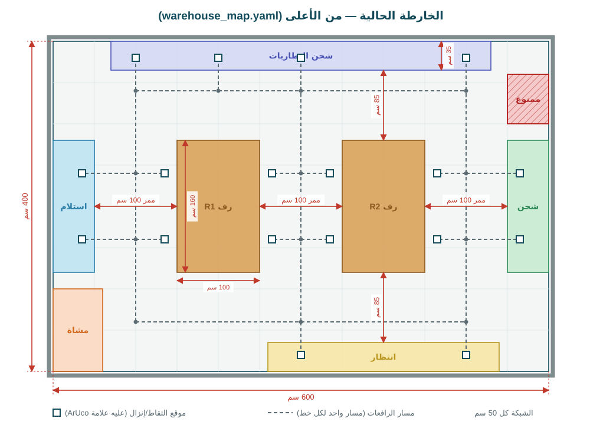
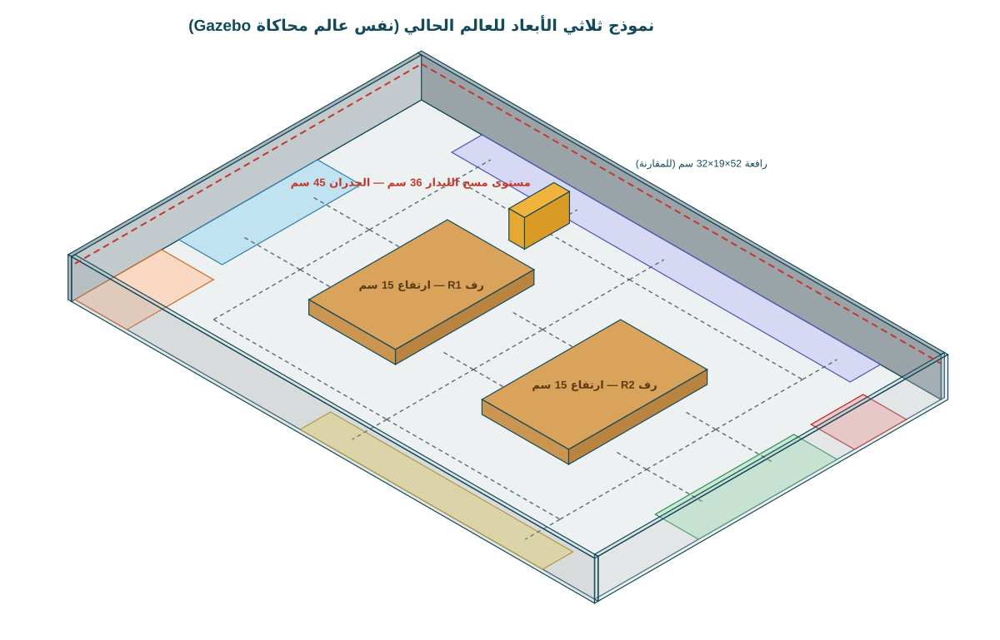
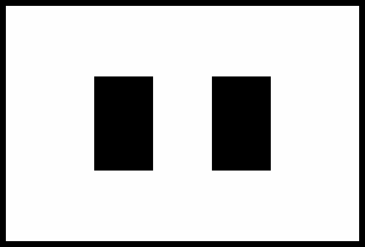
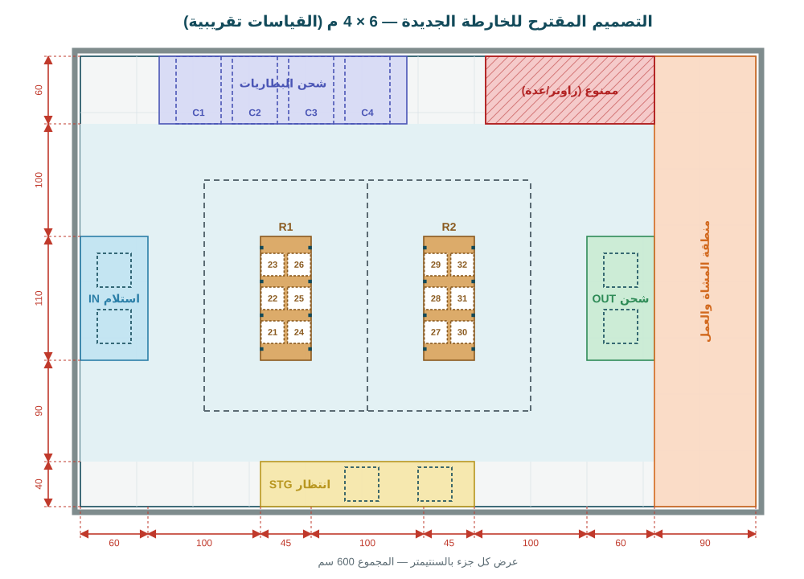
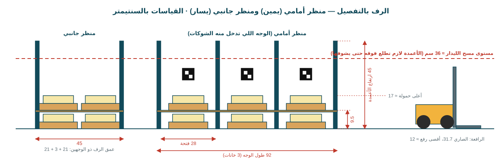
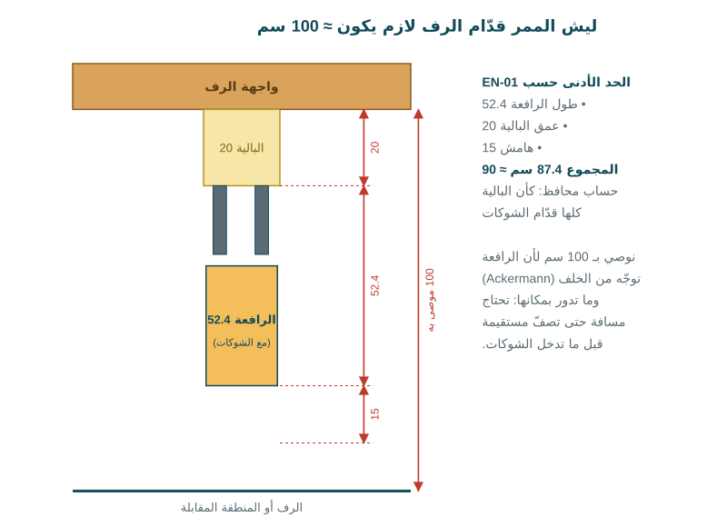

# خارطة المخزن المصغّر: الحالية ومتطلبات تصميم الخارطة الجديدة

هذا الملف يشرح ثلاث أمور:

1. **الخارطة الحالية** المستخدمة بالخادم ولوحة المراقبة والمحاكاة، مع النماذج المتوفرة منها.
2. **مشاكل الخارطة الحالية** اللي لازم تنصلح بالتصميم الجديد.
3. **متطلبات الخارطة الجديدة**: مكوناتها، تفاصيل كل مكوّن، والقياسات التقريبية الموصى بها، مع تصميم مقترح جاهز.

نسخة للطباعة: [warehouse-map-design.pdf](warehouse-map-design.pdf).

> **مهم:** كل القياسات هنا مبنية على أبعاد الرافعة الحالية (Huina 1577 Pro: طول 52.4 سم، عرض 18.7 سم، ارتفاع 31.7 سم)
> وعلى تقديرات لأبعاد ثانية (أقصى رفع للشوكة ≈ 12 سم، نصف قطر الدوران ≈ 35 سم). بعد ما نقيس الرافعة
> ([دليل القياسات](../measurements/README.md)) نعدّل الأرقام اللي تتأثر. القواعد بالقسم 4 تبيّن شلون ينحسب كل رقم.

---

## 1. الخارطة الحالية

الخارطة محفوظة بملف واحد: `backend/app/warehouse_map.yaml`. منه تُرسم الخارطة بلوحة المراقبة،
ويُبنى عالم محاكاة Gazebo، وتُحسب مسارات الرافعات. الرسم التالي مأخوذ مباشرة من هذا الملف.

| العنصر | القياس الحالي |
|---|---|
| أرضية المخزن | 600 × 400 سم (24 م²) |
| الرفوف | رفّين (R1، R2)، كل رف 100 × 160 سم، بوجهين، خانتين بكل وجه، مستويين (الأرض و 6 سم) |
| الممرات قدّام الرفوف | 3 ممرات طولية بعرض 100 سم |
| الشوارع العرضية | شارع تحت وشارع فوق، كل واحد 85 سم |
| الاستلام والشحن | منطقة 50 × 160 سم لكل وحدة، بكل منطقة موقعين |
| الانتظار | 280 × 35 سم، موقعين |
| مواقف شحن البطاريات | 4 مواقف بشريط عمقه 35 سم |
| منطقة المشاة | 60 × 100 سم بالزاوية |
| منطقة ممنوعة | 50 × 60 سم |
| عدد المواقع | 16 موقع رف + 4 أرصفة + 2 انتظار = 22 موقع، و 4 مواقف شحن |

## 2. النماذج الثانية المتوفرة

### 2.1 الخارطة الحية بلوحة المراقبة

نفس الخارطة كما تظهر للمشغّل: الرافعات، المسارات المحجوزة، المواقع.

### 2.2 نموذج ثلاثي الأبعاد (عالم محاكاة Gazebo)

عالم المحاكاة مبني من نفس الملف: جدران 45 سم، رفوف 15 سم، والمناطق ملونة على الأرض.
الخط الأحمر يبيّن مستوى مسح الليدار (36 سم).

### 2.3 خارطة الإشغال (Occupancy grid)

الصورة اللي يحمّلها نظام الملاحة بالمحاكاة: الأسود = جدار أو رف، الأبيض = أرض فارغة، كل بكسل = 2 سم.

## 3. مشاكل الخارطة الحالية

1. **الرفوف كبيرة جداً.** رف 100 × 160 سم لبالية 20 × 20 سم يضيّع مساحة، وما يعطي غير خانتين بكل وجه (16 موقع رف).
2. **المستوى الثاني واطي (6 سم).** البالية على الأرض مع حمولتها ارتفاعها تقريباً 3.5 + 4 = 7.5 سم، فما تدخل تحت رف ارتفاعه 6 سم.
3. **مواقف الشحن ضحلة.** عمقها 35 سم والرافعة طولها 52.4 سم، فجسم الرافعة يطلع لشارع المرور. ونقطة الموقف بالملف
   (y = 3.80 م) مع شوكات طولها 21 سم قدّام المحور توصّل الشوكات للجدار (4.01 م).
4. **الليدار ما يشوف الرفوف.** الرفوف بالمحاكاة ارتفاعها 15 سم، والليدار يمسح على ارتفاع 36 سم، فيمر فوقها.
   الرف الحقيقي لازم تكون أعمدته أعلى من مستوى الليدار.
5. **الأرقام كلها تقديرية.** ما انقاس أي موقع على الأرض الحقيقية بعد (المطلوب ± 2 مم، EN-08).

---

## 4. قواعد التصميم (شلون ينحسب كل رقم)

إذا مساحة المخزن عندكم تختلف عن 6 × 4 م، طبّقوا هذه القواعد بدل ما تنسخون الرسم. الأولوية دائماً للممرات:
**لا تصغّرون الممرات حتى توفرون مساحة**، صغّروا منطقة المشاة أو الممنوعة أولاً.

| القاعدة | الحساب | الموصى به |
|---|---|---|
| الممر قدّام الرف (EN-01) | طول الرافعة 52.4 + عمق البالية 20 + هامش 15 = 87.4 | **100 سم** |
| الشارع العرضي (مسار واحد، تقاطعات فيها دوران) | الرافعة توجّه من الخلف وما تدور بمكانها؛ أقل نصف قطر ≈ 35 سم وأبعد نقطة بجسمها تلف بنصف قطر ≈ 53 سم | **90–100 سم** |
| زاوية التقاطع | منطقة فارغة 100 × 100 سم عند كل تقاطع، بدون زاوية رف أو عمود داخلها | فارغة دائماً |
| فتحة خانة الرف | البالية 20 + 4 سم من كل جهة | **28 سم** صافي (خطوة 30 سم) |
| عمق الرف ذو الوجهين | 2 × (عمق البالية 20 + 1) + فاصل 3 | **45 سم** |
| ارتفاع المستوى الثاني (EN-04) | ≤ أقصى رفع 12 − 2 = 10، و ≥ البالية 3.5 + الحمولة 4 + سمك الرف 0.9 + 1 = 9.4 | **9.5 سم** (سطح الرف) |
| ارتفاع أعمدة الرف | ≥ ارتفاع الليدار 36 + 5 | **45 سم** |
| ارتفاع الجدران (EN-07) | ≥ ارتفاع الليدار 36 + 5 | **45 سم** |
| موقف الشحن | العمق = طول الرافعة + 8؛ العرض = عرض الرافعة + 20 | **60 × 40 سم** |
| موقع البالية بالاستلام/الشحن/الانتظار | البالية 20 + 5 من كل جهة | مربع **30 × 30 سم** |

> إذا طلع أقصى رفع للشوكة (F بدليل القياسات) أقل من 11.4 سم، المستوى الثاني ما يصير، لأن البالية الأرضية مع حمولتها ما تدخل تحته.
> بهذه الحالة: إما نقلل ارتفاع الحمولة، أو نكتفي بمستوى واحد ونزيد عدد الخانات.

## 5. مكونات الخارطة الجديدة وتفاصيلها

| المكوّن | العدد | القياس التقريبي الموصى به | التفاصيل |
|---|---|---|---|
| أرضية المخزن | 1 | 600 × 400 سم | مستوية، لون فاتح **مطفي** (مو لمّاع)، بدون بلاط عاكس. الليدار وحساسات ToF تتأثر بالانعكاس (EN-06) |
| الجدران المحيطة | ≈ 20 م طول | ارتفاع 45 سم | غير شفافة، مطفية، بدون مرايا أو زجاج (EN-07). فوم بورد أو MDF أو كارتون مقوّى مثبت جيداً |
| الرفوف | 2 | 45 × 92 سم (منطقة الرف 45 × 110)، أعمدة 45 سم | رف بوجهين، 3 خانات بكل وجه، مستويين: الأرض + رف على ارتفاع 9.5 سم. أعمدة 2 × 2 سم على حدود الخانات |
| خانات الرفوف | 12 خانة × 2 مستوى = 24 موقع | فتحة صافية 28 سم | الحافة الأمامية للرف بدون بروز (حتى الشوكات تدخل)، سمك الرف ≤ 1 سم |
| الممرات الطولية | 3 | عرض 100 سم | ممر قدّام كل وجه رف؛ الرافعة تصفّ مستقيمة قبل ما تدخل الشوكات |
| الشوارع العرضية | 2 | 90 سم (تحت) و 100 سم (فوق) | تربط الممرات بالانتظار ومواقف الشحن؛ مسار واحد، ونظام المرور يحجز كل قطعة لرافعة وحدة |
| منطقة الاستلام (IN) | 1 | 60 × 110 سم | موقعين للبالية (مربع 30 × 30)، تفتح على الممر الأول |
| منطقة الشحن (OUT) | 1 | 60 × 110 سم | موقعين للبالية، تفتح على الممر الثالث |
| منطقة الانتظار (Staging) | 1 | 190 × 40 سم | موقعين للبالية، تحت الشارع السفلي |
| مواقف شحن البطاريات | 4 (3 + احتياط) | كل موقف 40 × 60 سم | الرافعة تدخل للموقف من الشارع العلوي؛ علامة الموقف على الجدار بنهاية الموقف |
| منطقة المشاة والعمل | 1 | 90 × 400 سم | ممنوعة على الرافعات: لابتوب الخادم، الراوتر، الشخص اللي يحط الباليات. مكان اختبار كشف المشاة |
| منطقة ممنوعة (Keep-out) | 1 | 150 × 60 سم | مخطّطة؛ للعدة والشواحن والأسلاك |
| الباليات (EN-05) | 10–20 | 20 × 20 × 3.5 سم | نفس الموديل كلها، حمولة ثابتة الوزن وارتفاعها ≤ 4 سم، علامة ArUco 30 مم (الأرقام 1–20) على الوجه الأمامي |
| علامات المواقع ArUco (EN-08) | 22 | 60 × 60 مم | 12 للخانات (21–32)، 4 للأرصفة (33–36)، 2 للانتظار (37–38)، 4 لمواقف الشحن (39–42). مطبوعة على ورق **مطفي** |
| خطوط الممرات | حسب الحاجة | شريط 2–3 سم | للعرض فقط (EN-06)، الرافعة ما تعتمد عليها. شريط مطفي |
| مجسمات أشخاص (EN-10) | 3–5 | ارتفاع ≈ 12 سم (مقياس 1:14) | لاختبار كشف المشاة بالكاميرا |
| الإضاءة (EN-09) | — | ≥ 300 لوكس | منتظمة، بدون شمس مباشرة على الأرض |
| راوتر Wi-Fi | 1 | — | بمنطقة العمل، يغطي كل الأرضية |

**مجموع المواقع:** 24 موقع رف + 2 استلام + 2 شحن + 2 انتظار = **30 موقع**، و 4 مواقف شحن. يكفي لـ 10–20 بالية
مع مواقع فارغة حتى الرافعات تنقل بينها.

> **ملاحظة على أرقام العلامات:** الإعدادات الحالية تحجز الأرقام 21–40 لعلامات المواقع (PC-03)، والتصميم الجديد يحتاج 21–42.
> القاموس المستخدم (DICT_4X4_50) فيه الأرقام 0–49، فالتوسيع تعديل صغير بالإعدادات أسويه أنا.

## 6. التصميم المقترح

- **الأرقام داخل الرفوف** هي أرقام علامات ArUco لكل خانة.
- **المربعات المنقطة** هي مواقع الباليات بالاستلام والشحن والانتظار.
- **C1–C4** هي مواقف شحن البطاريات.
- **الخطوط المنقطة الرمادية** هي مسارات الرافعات.
- **اللون الأزرق الفاتح** هو المساحة اللي تتحرك بيها الرافعات، ولازم تبقى فارغة دائماً.

## 7. الرف بالتفصيل

- **المستوى الأول:** البالية على الأرض، بين الأعمدة.
- **المستوى الثاني:** سطح الرف على ارتفاع 9.5 سم، وسمكه ≤ 1 سم (MDF أو خشب 9 مم).
- **علامة الموقع:** ArUco 60 مم على الوجه الأمامي فوق الخانة، وبنفس الارتفاع لكل الخانات. الارتفاع النهائي نثبته بعد ما نركّب الكاميرا ونجرّب.
- **الأعمدة:** تطلع لارتفاع 45 سم حتى الليدار يشوف الرف ويعرف مكانه.

## 8. ليش الممر 100 سم

---

## 9. بعد ما تبنون الخارطة: شنو تبعثولي

1. **رسم بالقياسات:** على ورق مربعات أو صورة من الأعلى، والقياسات كلها من زاوية ثابتة وحدة (مثلاً الزاوية اليسرى السفلى).
2. **إحداثيات كل موقع:** الخانات، مواقع الاستلام والشحن والانتظار، ومواقف الشحن. القياس من نفس الزاوية الثابتة وبدقة ± 2 مم:
   مركز موقع البالية، واتجاه الدخول إليه.
3. **الرفوف:** الارتفاع الحقيقي لكل مستوى، وارتفاع علامة كل موقع عن الأرض.
4. **صور:** صورة لكل منطقة، وصورة للمخزن كامل من الأعلى إذا تقدرون.

أنا أحدّث `warehouse_map.yaml`، وأعيد بناء عالم Gazebo وخارطة الإشغال، وتتحدث لوحة المراقبة تلقائياً.
